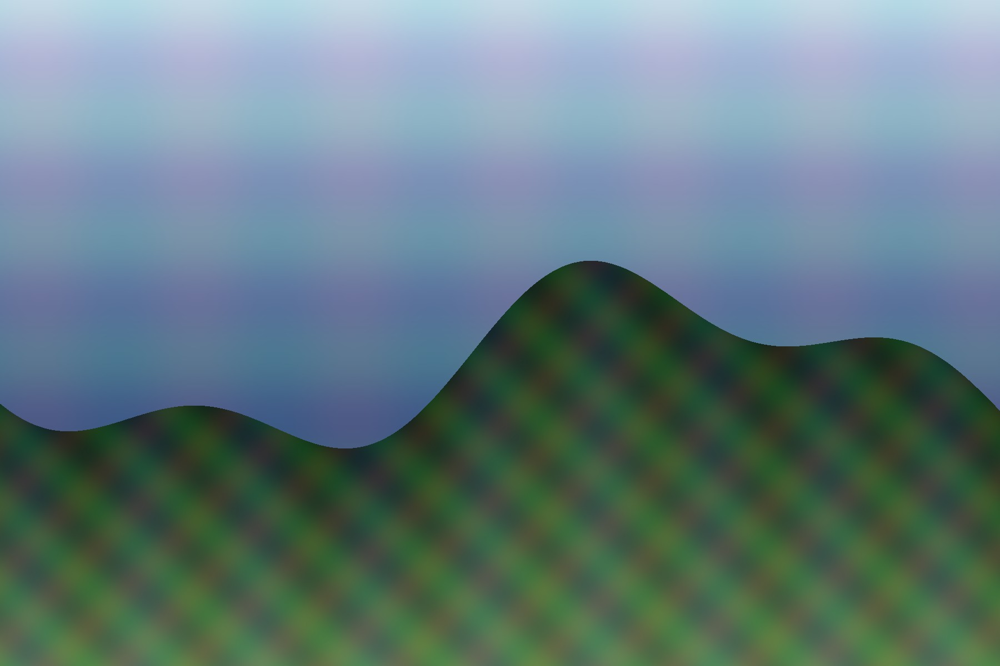

The `picture:` above is the listing thumbnail and the article hero.

A picture in the body is the same pipeline — the master's name, ladder, figure:

Quire encodes the ladder, writes `width` and `height` so nothing shifts while it
loads, picks the format from what the picture actually is, and styles the figure
and the listing thumbnail from the default look.

A recording is placed the same way, with a still of the same name beside it as
its poster: `bake.png` for `bake.webm`.

