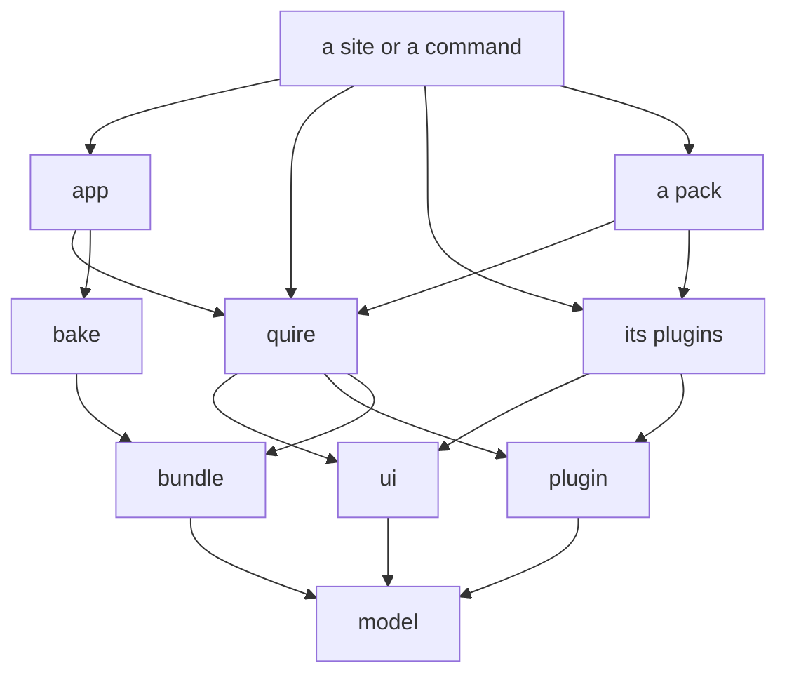

The other pages say how to use Quire. This one says why it is built the way it is.
You do not need it to build a site. Read it when a rule elsewhere seems arbitrary, or before changing Quire itself.

## The short version

- **A site is known by its blueprint, not its folder.** One description of the site drives both the bake and the serving, so the two cannot disagree.
- **The bake converts and serving composes.** Everything slow happens once, ahead of time, and the binary that serves cannot convert at all.
- **Layers only point down.** The data knows nothing of the components, and the components nothing of the site built from them.
- **The look is tokens.** Sheets read roles and scale properties, never a hue or a pixel width.

## One blueprint

Bake and serve run the same blueprint. The folder is not a second answer to what the site contains. A file reaches the bundle because the blueprint read it or referred to it. `AddFile` ships anything else.

Dev may run a step lazily. It may not skip one. A variant is in a journal or it is an error, in every mode.

A bake reads the source tree. What that run renders is thrown away: source order is the measured bytes, and those exist only after the encode.

A bake has no server. The routes and pages a blueprint declares are written down and never served. Plugins and raw routes are not `Declare`'s to add: they are on the handle given to a blueprint's `Live`, which only serving calls, since neither can add to a bundle. So a route two patterns contend for, or a plugin that fails to attach, is found when the site boots, not when it bakes.

The bake converts and serving composes. Markdown, masters and mermaid are converted once, by the bake; a template places what came out. A document reaches the bundle as HTML with a slot for each picture and each named fence. The bake fills what it can, a fence in a language it highlights, and serving fills the rest: a picture from the journal with the markup `ui` makes today, a widget by running it. So a change to the scale, to `ui` or to a widget needs no rebake, and one master referred to twice is one slot.
The bake is never told which fences a site has widgets for. A widget named for a language is found when the site is built, because that fence arrives already filled, and it is an error and not a silent choice between the two.

Everything the bake makes is one kind of thing: a journal record, keyed by what it was made from, naming content-addressed files. A record is what every baked thing has in common: its name, its kind, its key and its files. Whatever one kind needs beyond that is a payload only a reader of that kind understands; a picture's is its master and the width of each file. A document, a mermaid diagram and a share card are each one file; a master is its ladder. One check decides what is remade, one copy decides what ships, and one lookup finds it again.

The baker knows no formats. It keeps the cache, the keys and the journal, and is handed what converts: a converter, which turns an input into one file, and a codec, which opens a master once and gives any number of rungs.
Markdown, mermaid and the share card are converters and the picture codec writes WebP, each a package of its own, so a bake links only what it is handed.
What a site asks of a bake and of a bundle is the same few requests, and each carries everything its output depends on.

Something that must convert per request is a plugin that imports its converter.

## Journal

A journal is an authority. One that will not write fails the build. It is written whole and renamed into place. A variant is one content-addressed file, so a crash leaves it whole or absent.

The bundle is linked from the cache. Nothing edits a bundle file in place.

A key holds everything its output depends on: the input, the settings, and the converter's version. Each converter states its own version, which changes by hand, so a refactor rebuilds nothing; a release check fails on any converter whose code or dependencies moved since its version was set.

`quire` does not import the baker, so a program that serves with it cannot convert: no codec, no markdown, no highlighter.
`Run` bakes and serves in one program, so `quire_nobake` swaps its bake half for a stub.
Where the bundle lives is a separate choice. The bake writes `.quire/ship.go`, which embeds the bundle and hands it to `Ship`; a build adds that file with `-overlay .quire/ship.json`, and without it the bundle is read off disk. A shipped static site uses the tag and the overlay, a CMS uses neither, and a binary built with the tag alone serves a bundle kept beside it.

## Packages

Layers only point down, and a test holds them to it.

`model` is the data, and imports nothing of Quire's but the colour scales. It holds the two structures a converter makes and a site reads: a baked document and a picture.
`bundle` opens what a bake left, over any `fs.FS`, and is otherwise opaque. The journal and its records are private to it and the baker.
`ui` and `plugin` import `model` and nothing else of Quire's.
`quire` is the site and the server, and `bake` is the baker. Neither imports the other.
`app` is the helpers over both, `Run` among them, and nothing below imports it.
A site, a command, a pack or `app` is the only importer of `quire`.

A plugin sits beside `ui`, and a site opts in with `Use`, in its `Live`. A plugin Quire ships is a package under `plugin/`, written against the same API as any other.

A pack sits above `quire`: it is a blueprint somebody else wrote, with the same `Declare` and `Live` a site's own has, and a site hands it to `Run`. A pack Quire ships is a package under `pack/`, and it calls nothing a site could not.

## Scale

The column is 336 because that is the widest one that still fits two of them on a 744px tablet, the narrowest worth keeping off the phone layout.

How wide a picture goes is where it is placed, so one wide page does not make every thumbnail pay for that width.

`sizes` sees the viewport, not the container. Between the two-column width and the three-column width a `.page` is already capped and a `.page--wide` is still growing, so the cells differ in that band.

`SizeBleed` measures in `cqw` against `main`. `100vw` counts the scrollbar.

A sheet reads the scale's variables and never writes a width query. `WithStylesheetsAt` attaches CSS to a step.

`--qr-measure-text` is `ch`, because a comfortable line belongs to the font. `.prose` is a breakout grid so a figure is not capped with the text.

Every custom property is `--qr-*`. A plugin uses its own prefix. Overriding a `--qr-*` token is a tweak, the same act as `WithScale`.

## Colour, fonts, diagrams

A palette is roles. Sheets read the role, never a hue, and do not mix tints. The scales are Radix, because the light and dark pairs are already tuned. A test holds text contrast.

A browser face is woff2. Measuring text needs TTF, and only a bake measures, so the two files stay apart. Quire writes `--qr-font` and `--qr-font-mono`.

Mermaid is the diagram format editors already preview. The renderer is heavy, so it lives on the bake side. A diagram is inlined so it can see the page's custom properties. The site asks for it by its source and the font set, so a bake and a site on different fonts fail the load.

## Layers

Base is `quire` and the default look. `examples/1-minimal` is the proof. A pack is opt-in and is not the base. A site is not a pack.

Quire ships a class only if it ships the rules for it.

## Serving

A site is a blueprint run over a source, and has no server in it. Its routes are a table.
The server makes a mux from the table and adds what claims the whole address space: the not-found page for every other path, `robots.txt`, the sitemap, the health check, the `www` redirect and the session cookie.
So a host that serves a site some other way is bound by none of those.
A site's own files are not among them: its pictures are routes in its table, under `/_quire/`, so they go wherever the site is mounted.

What fails while a site is built is returned, not panicked: a route two patterns contend for, a file that will not read, a page that will not render.

What happens to a response follows the response, not the mode.

A fixed page is rendered once when the site is built. A collection item is cached under its path and coding. Anything else goes straight to its handler. The cache key has no method and no cookie, so a stored body is the same for every visitor.

Building closes the site. A route added after it panics.
