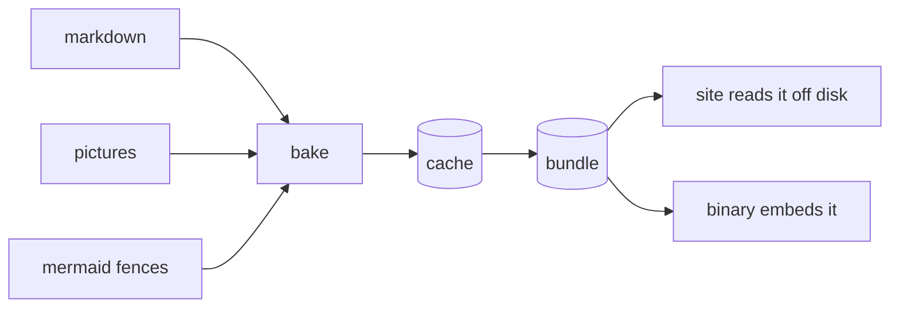

Baking is the step that turns the content folder into what the site serves: HTML from markdown, WebP from pictures, SVG from diagrams.
It is part of the site's own binary, so there is no separate tool to install or keep in step.

## When it runs

A site binary that can bake, and has no embedded bundle, bakes before it serves. `go run . bake` bakes and exits.



Day to day you do nothing: `go run .` bakes what changed and serves.
You run `go run . bake` yourself when you build the binary that ships.

## What it makes

The bake mounts the site, reading the content tree rather than the bundle, and makes what the mount asked for:

- every variant of every master a document or the mount referred to;
- every diagram in what it loaded;
- the share card;
- every document the mount asked for, converted to HTML with its headings and raw frontmatter, one file each in the journal like any other artifact, and skipped next time unless its source, the converter or the site's widget names change;
- a bundle (`.quire/bundle`) holding those files and a journal naming only them. Everything in it is a journal record: a site reads nothing else from the bundle.

Nothing else in the content tree reaches the bundle.
A file nothing refers to, a PDF say, is shipped with `AddFile`, and an icon with `WithIcons`.

## The cache and the bundle

Both live under `.quire`, beside the site.

- The **cache** (`.quire/cache`) is incremental: over an unchanged library a bake costs a hash per master. Files a narrower bake did not ask for stay in the cache until it is wiped.
- The **bundle** (`.quire/bundle`) is fresh each time, so stale files cannot ship.

The bake writes `.quire/.gitignore` ignoring everything in it, itself included: `.quire` is never committed and can be deleted at any time.

A site reads the bundle off disk when it can bake and out of the embed when it cannot, the same artifact either way.
It never encodes: a variant it was not given is a 404.

## Controls

`WithBake` is the whole control, with paths relative to where the bake runs:

```go
quire.WithBake(model.BakeSpec{
  Content: "content", // the default
  Dir:     ".quire",  // the default; holds bundle/ and cache/
})
```

## The shipped binary

Two build choices decide what a binary carries.

- `-tags quire_nobake` swaps the bake for a stub and links none of it, so the binary cannot convert: no codec, no markdown, no diagram renderer.
- `-overlay .quire/ship.json` embeds the bundle. Without it, the binary reads `.quire/bundle` off disk.

Which to use:

- **A static site** uses both. `go run . bake`, then `go build -tags quire_nobake -overlay .quire/ship.json`. The result is one file that serves from any directory. See [Getting started](./getting-started.md#ship-it).
- **A binary with the bundle beside it** uses the tag alone, and serves a `.quire/bundle` mounted next to it.
- **A CMS**, which bakes uploads, uses neither.

## In depth

A bake works out what to make from the mount, not from the folder. The reasons, and how the journal keeps a bake safe to interrupt, are on the [Design](./architecture.md#one-mount) page.

Each converter (markdown, diagram, card, picture) has a version, and the version is part of the key every artifact is stored under. When a release changes what a converter produces, its version changes, and the next bake remakes exactly those artifacts.
