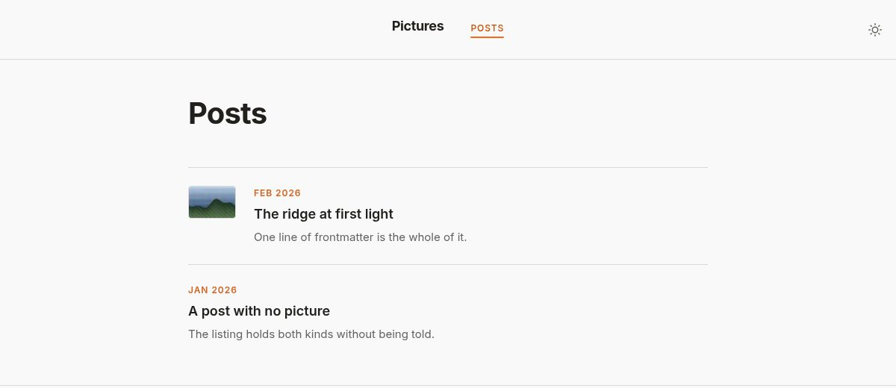
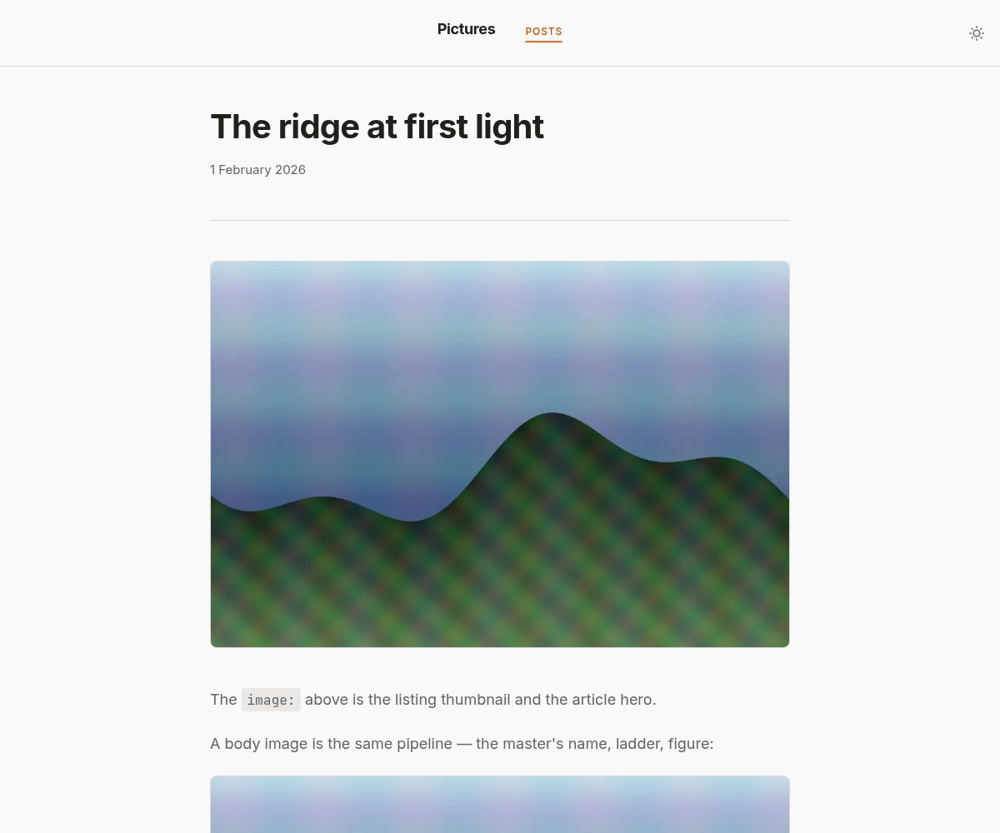
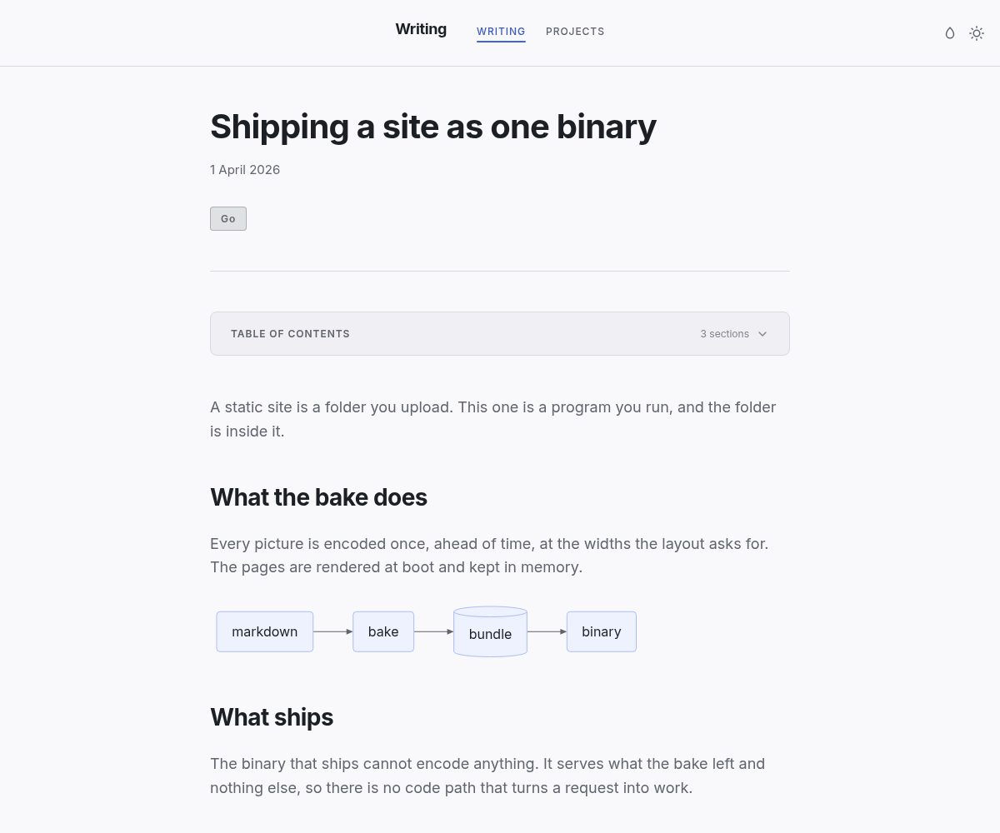
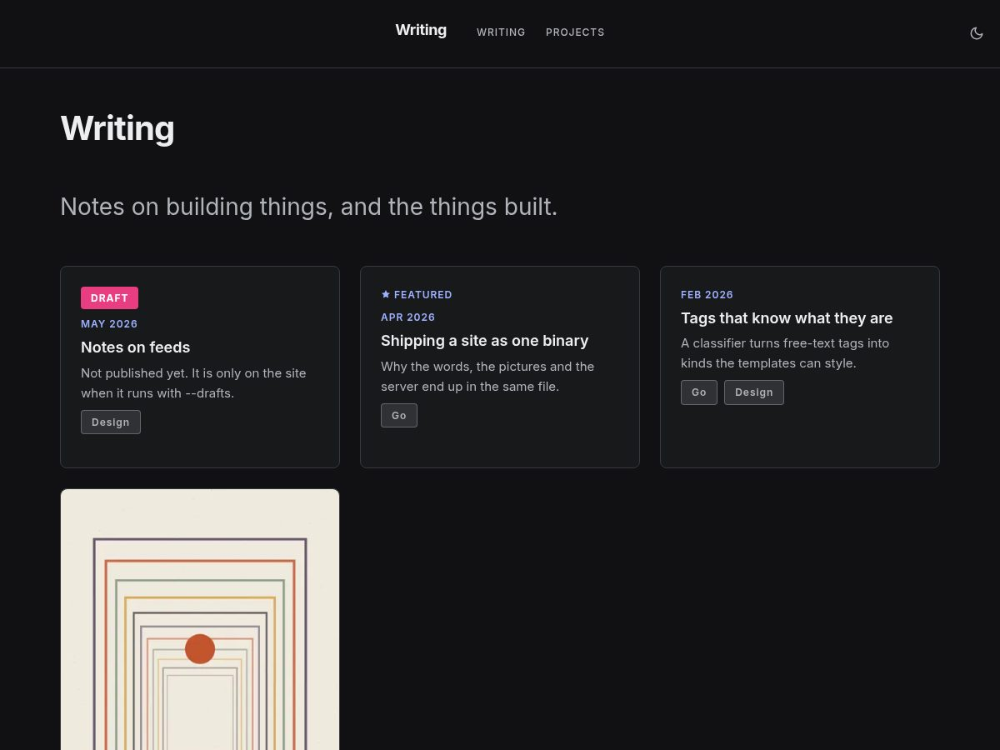
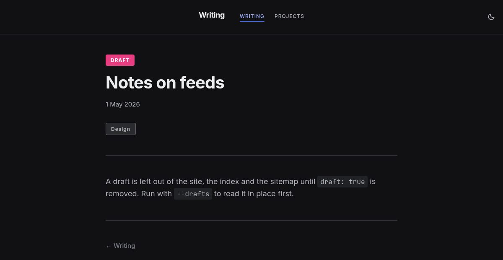

A blog is the site Quire makes with nothing added: one collection of dated documents.
[Getting started](./getting-started.md) builds one by hand, and `quire new mysite` copies one.

```go
func main() {
  app.Run(model.Identity{Name: "Pictures", BaseURL: "https://example.com"},
    quire.BlueprintFunc(func(site *quire.Site) error {
      _, err := site.AddCollection(model.Basic{ID: "posts"})
      return err
    }))
}
```

## A post

A post is a file in `content/posts`.

```markdown
---
title: The ridge at first light
date: 2026-02-01
summary: One line of frontmatter is the whole of it.
picture: ridge.jpg
tag: [Go]
---

The body.
```

Each field shows up somewhere, and none of it needs a template.

## The index

`/posts` lists every post, newest first: its month, title and summary, and its `picture` as a thumbnail.



## The post's page

`/posts/{name}` is the post: its title and date, its `picture` as the hero, then the body.



Tags sit under the date, and a post with headings gets a table of contents.



## What else you get

- **A home page** with the site's name, its description and a link to each collection. `AddPage("/", …)` replaces it.
- **Navigation**, with the collection in it, and a light and dark toggle.
- **`sitemap.xml` and `robots.txt`**, once `BaseURL` is set.
- **A share image** for each post: its `picture`, or the site's card when it has none.

## Drafts and featured posts

- `draft: true` keeps a post out of the site and the sitemap. `--drafts` shows it, badged, so it can be read in place before it is published.
- `featured: true` marks a post. `Collection.Featured()` selects them, for a home page of your own to show first.

A card badges both. This is the themed example's home page, run with `--drafts`:



The draft's own page carries the badge too:



## Tags

A `tag` is free text until the site declares its vocabulary, and then a tag outside it fails the load:

```go
model.Basic{ID: "posts", Tags: model.Tags{"lang": {"Go"}, "topic": {"Design"}}}
```

Each tag is drawn with a class for its kind, so a language and a topic can look different. See [Content](./content.md#tags).

## Going further

- [Content](./content.md) is everything a post can hold.
- [The look](./look.md) changes the colours and fonts, or replaces a page.
- The `themed` example has a home page, a tag vocabulary and a palette of its own.
