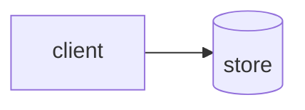

A site's words live in a `content` folder, as markdown files.
The mount groups them into collections, and each collection gets an index page and a page per document.

## A document

A document is YAML frontmatter between `---` fences, then a markdown body.

```markdown
---
title: Tags that know what they are
date: 2026-02-01
summary: A classifier turns free-text tags into kinds.
tag: [Go, Design]
---

The body starts here.
```

The file's name is its address: `content/posts/hello.md` is served at `/posts/hello`.

## Frontmatter

The stock fields are `model.Meta`:

- `title`: the page title.
- `summary`: one line, shown in listings and used as the page description.
- `date` and `updated`: ISO dates, `YYYY-MM-DD`.
- `image`: a picture beside the document. See [Pictures](#pictures).
- `tag`: a YAML list, `tag: [Go, NATS]`.
- `draft`: leaves the document out unless the site runs with `--drafts`.
- `featured`: marks the document so a page can select and badge it.

An unknown key is a load error, so a typo cannot pass silently.
A `---` in the body is an ordinary rule.

### Fields of your own

A site that needs more fields declares a type that embeds `Meta`:

```go
type Piece struct {
  model.Meta `yaml:",inline"`
  Medium     string `yaml:"medium"`
}
```

and mounts the collection as `model.Spec[Piece]` instead of `model.Basic`.

### Dates

Dates are parsed once at load into `Date`. Anything that is not ISO fails the build, so a bad date never reaches a page.
`Site.Dates` is the layouts dates render in, day first by default, and a collection's `LongDate`, `ShortDate` and `ShortMonthYear` format a `Date` to it.
`Date.ISO()` is the machine form. Sitemaps and structured data always use it.
A custom formatter takes a parsed `Date`, so it only formats.

### Drafts, featured and other state

`draft` and `featured` are the two states the engine acts on. Drafts are filtered from the build and the sitemap unless `WithDrafts`. Featured is only ever selected and badged.
Anything else a document says about its own state is the site's vocabulary: override `Badges() []Marker` on the site's type and Quire renders what it is handed, knowing none of the words.

## Markdown

The body is standard markdown, with these additions.

### Pictures

`` is a picture. The path is relative to the document, like a link (`archr/columns.png`), or from the content root when it starts with `/`.
A picture in a paragraph of its own becomes a `.figure`; one inside a sentence stays an inline ``.
A figure's text is both its caption and its alt text, as in Pandoc. Write `` when the two should differ.
An `http(s):` picture is left alone, and a missing file fails the load.

The frontmatter `image` resolves the same way. The default look renders it as a listing thumbnail, an article hero and the share image, with no CSS of your own.

### Code

A fenced code block is highlighted, and gets a copy button that shows on hover.

### Headings

Every heading gets an id, and a link that shows on hover so a reader can copy the address of a section.
The table of contents on a page lists H2 and H3.

### Links between documents

Link to another document by its file: `[Baking](./bake.md)` or `[one](../posts/one.md#part)`.
The link is written as the address of that document's page, so the same markdown works on a forge and on the site.

### Diagrams

A fence named `mermaid` is a diagram.

````markdown

````

It is drawn by the bake and inlined as SVG, so the palette and the fonts reach it.
Nodes take a light tint of the accent. `class n swatch2` or `n:::swatch2` tints one with any role (`accent` `spot` `swatch1`…`4` `red` `green` `amber`), and a forge's preview just ignores the class.
A diagram the bundle does not hold fails the load, as does one measured in other fonts than the site serves.

### Callouts

A blockquote that opens with one of GitHub's markers renders as a `.callout`:

```markdown
> [!WARNING]
> Mind the gap.
```

The markers are `[!NOTE]`, `[!TIP]`, `[!IMPORTANT]`, `[!WARNING]` and `[!CAUTION]`. Any other blockquote is still a quote.

### Styled spans

`[text]{.class}` is a span with those classes, Pandoc's bracketed span. It styles a few characters with the site's CSS without writing HTML. The text is literal and the braces take classes only.

### Raw HTML

Raw HTML in the body is rendered as it is, because the markdown is the site's own.

## Widgets

A widget turns a named fence into HTML of the site's choosing.
`Spec.Widgets` maps a fence's name to a `Widget`, which is handed the rest of the fence's first line and its body.

```go
var widgets = map[string]model.Widget{
  "swatch": func(_, body string) (string, error) {
    return `<p class="swatch">` + strings.TrimSpace(body) + `</p>`, nil
  },
}
```

A fence named `swatch` in that collection's documents now renders as the chip.

- `mermaid` and `palette` are Quire's own widgets, and a site's widget of either name replaces it. `palette` draws each role it names (`neutral accent spot`, …) as its twelve steps, from the page's own custom properties.
- A fence shown inside a longer fence stays code, so a page can show a widget's syntax without running it.
- A widget runs when the page is composed, not in the bake, so changing one needs no rebake. The bake records only where each fence sits.
- A widget that returns an error fails the load, the same as bad frontmatter.

## Collections

`AddCollection` loads the documents matching a glob and mounts them.

```go
notes, err := e.AddCollection(model.Basic{ID: "writing", Title: "Writing"})
```

That reads `content/writing/*.md`, serves an index at `/writing` and each document at `/writing/{slug}`, adds the collection to the navigation, and records its pages in the sitemap.

The fields of a `Spec`:

- `ID` names the folder and the URL.
- `Title` and `Description` are shown on the index.
- `Markdown` is the glob, when it is not `{id}/*.md`.
- `Index` and `Item` replace the index and document pages. Nil renders `Listing` and `Article`, which show the title, date, tags, hero, contents and body, and link back to the index. Each is handed `model.Shell` as well as the collection, so it needs no closure over the engine.
- `Sort` orders the documents: a comparison, as `slices.SortFunc` takes. Without it they are newest first. Documentation has no dates, so this site keeps one list of its pages in order and sorts on a document's place in it.
- `Kicker` labels each document in `Entries` rows and cards. Nil uses `ShortMonthYear`. `Entries(c, docs)` renders the same rows anywhere.
- `Widgets` and `Classifier` are covered on this page.

Other things to know:

- `model.Basic` is `Spec[Meta]`, the spec for stock frontmatter.
- Drafts are dropped unless `WithDrafts`. A collection that is empty after that is not mounted.
- A missing slug is the site's 404. Two documents with one slug fail the load.
- `Featured()` selects from a collection, and `Docs()` is all of it, in order.
- `Neighbours(d)` is the documents before and after `d` in that order; either is nil at an end. `ui.Pager` renders them as previous and next links.

## Tags

A tag is typed by hand, so it is whatever the writer typed. A classifier is the site's tag vocabulary: it says which tags are which kind.

```go
var kinds = model.NewClassifier(
  model.Exact("lang", "Go"),
  model.Exact("topic", "Design"),
)
```

Set it as `Spec.Classifier`. Every `tag` must then classify or the load fails, so a new term cannot ship unstyled.
`NewClassifier` takes `Exact(category, needles…)` rules, tried in order, and the first match wins. A needle matches the whole value, ignoring case.
`Collection.Tags(d)` is a document's tags as markers carrying their category, ready for `ui.Tags`, which gives each a class for its kind (`tag-lang`, `tag-topic`).

## Markdown outside a collection

A page built in Go can still use baked markdown. `e.Markdown(name)` returns one file under the content root as a component:

```go
sample, err := e.Markdown("home/sample.md")
```

The file is an ordinary document, frontmatter fences included, even when they are empty. Everything on this page works in it: highlighted code, pictures and diagrams.
This site's landing page gets its code sample that way.

## In depth

Markdown is converted by the bake, not by the serving binary. A shipped binary holds the HTML and not the markdown, and links no markdown library.
The bake leaves a hole in that HTML for each picture, diagram and widget, and serving fills the holes. That is why a change to a widget, to the scale or to a component needs no rebake.
