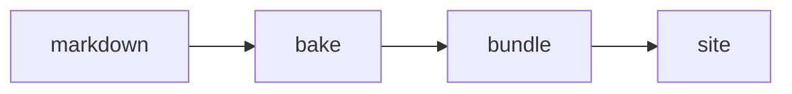
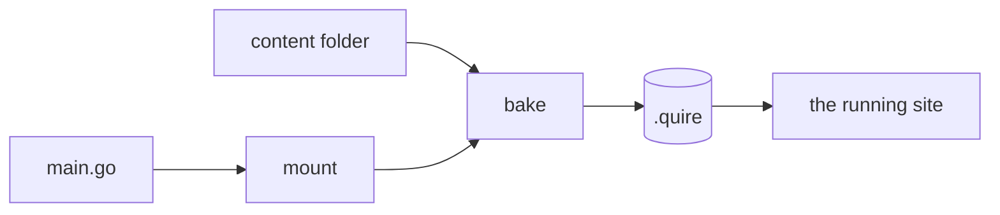

Quire is a Go library. A site is a small Go program that calls it, and a folder of markdown beside that program.
This page builds one from an empty directory.

## Before you start

You need Go 1.27 or later. Nothing else is installed: no Node, no image tools, no separate command.

## Make the site

Start a module and add Quire to it.

```sh
mkdir site && cd site
go mod init example.com/site
go get github.com/lahickey/quire
```

Write `main.go`:

```go
package main

import (
  "github.com/lahickey/quire"
  "github.com/lahickey/quire/model"
)

func main() {
  quire.Run(model.Site{Name: "Example", BaseURL: "https://example.com"},
    func(e *quire.Engine) error {
      _, err := e.AddCollection(model.Basic{ID: "posts"})
      return err
    })
}
```

Then write a first document, `content/posts/hello.md`:

```markdown
---
title: Hello
date: 2026-02-01
summary: The first post.
---

Some words.
```

## Run it

```sh
go run .
```

Open http://localhost:8090. You have a home page, a post index at `/posts`, the post at `/posts/hello`, navigation, a light and dark toggle, `sitemap.xml` and `robots.txt`.
There are no templates and no CSS of your own: `model.Basic` is a collection of documents with the stock frontmatter, and Quire supplies the look.

`Run` takes a few flags:

- `--addr` sets the address. The default is `:8090`.
- `--dev` turns on live reload and stops the browser caching pages.
- `--drafts` includes documents marked `draft: true`.
- The argument `bake` bakes and exits instead of serving.

Run it from the site's directory.

## Add a picture and a diagram

Put a picture beside the document and name it in the frontmatter.

```markdown
---
title: Hello
date: 2026-02-01
image: ridge.jpg
---


```

The `image:` line gives the post a thumbnail in the index, a hero on its page and a share image.
The picture in the body becomes a figure with a caption.
Each is served as WebP in several widths, and the browser picks one. See [Images](./images.md).

A fence named `mermaid` is a diagram:

````markdown

````

See [Content](./content.md) for everything markdown can do.

## What just happened



Three ideas cover most of Quire.

- **The mount.** The function you hand to `Run` is the mount. It says what the site holds: its collections, pages, routes and plugins. It is the only description of the site.
- **The bake.** Before it serves, the binary bakes. It runs the mount, converts the markdown it asked for, encodes the pictures, draws the diagrams, and writes the results into `.quire`. A second run only redoes what changed.
- **The bundle.** What the bake wrote is the bundle. The site serves from the bundle and never converts anything while serving.

Everything under `.quire` is made by the bake, so deleting it is a clean start.

## Ship it

The shipped binary carries its bundle inside it.

```sh
go run . bake
go build -tags quire_nobake -overlay .quire/ship.json
```

That binary serves what it embeds from any directory, links no converter, and refuses to bake.
The bake writes `.quire/ship.go`, which embeds the bundle, and the overlay adds that file to the site's package for this build only. Nothing needs `.quire` to exist before the first bake.
See [Baking](./bake.md) for the other ways to ship.

## Where next

- [Content](./content.md): frontmatter, markdown, collections and tags.
- [The look](./look.md): change the palette, fonts and CSS, or replace a page.
- [Wiring](./wiring.md): the site's settings, options and routes.
- [Plugins](./plugins.md): add behaviour, such as a basket or search.

The repository's `examples/` are complete sites, each adding to the one before:

- `1-minimal` is the site on this page.
- `2-pictures` is the same code with pictures and a diagram in its content.
- `3-themed` has a look of its own.
- `4-plugin` is a shop with a basket plugin.
