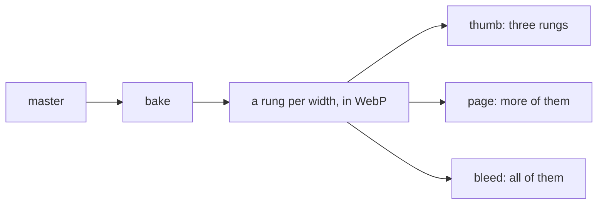

You put a picture beside a document and refer to it. Quire does the rest: it encodes the picture at several widths, writes the markup that lets the browser choose one, and serves the files.

## Using a picture

There are two ways to refer to one, and both go through the same pipeline.

```markdown
---
title: The ridge at first light
image: ridge.jpg
---


```

- `image:` in the frontmatter is the document's picture: its thumbnail in listings, the hero on its page and its share image.
- `` in the body is a figure in the text.

The markup carries `width` and `height`, so nothing shifts while a picture loads.
In a template of your own, place a document's picture with a component:

```templ
@ui.Img(doc.Image, model.SlotPage, title)
```

## Masters

A picture content refers to is a **master**, and it lives beside the documents that use it.
The bake encodes it; the site embeds the bundle and never a master.
A master is JPEG, or lossless WebP when it has alpha. Every variant is lossy WebP.

Most sites commit their pictures as they are and never think about this.

> [!CAUTION]
> A picture committed by hand keeps its EXIF, XMP and ICC profile in the repository, GPS from a phone included. Quire strips them only from what it writes, so run a phone picture through `quire ingest` first.

For a source too big to commit, `quire ingest` writes a master from it: 8-bit, long edge at most `max(2560, widest slot)`, EXIF/XMP/ICC stripped, and nothing beside it.
A source already under the cap is not upscaled, and shrinking one says so.

```sh
go run github.com/lahickey/quire/cmd/quire ingest art eight-thirty ./press.tif
```

## Slots

A slot says how wide a picture is shown where it is placed.
Slots are widths, not roles: `thumb`, `column`, `page`, `page-wide`, `page-full`, `bleed`, narrowest first, and the set is closed.
A card is rendered at a column and a hero at a page; the template says where, and the slot's name says how wide.

`HeroFigure(im, SlotBleed, …)` is the whole of running one to the window edge, with fetch priority.

## The ladder



The ladder is one global list of widths from a thumbnail up to the cap. Nothing about a layout reaches it: a width taken from the grid is wrong as soon as a site's own sheet changes the grid.
An image offers the rungs below its master plus the master itself, so art authored at an exact width is served at it and nothing is upscaled.
A slot picks which rung `src` lands on and where `srcset` stops, so a 4rem thumb lists three rungs, not ten. Every image with the same master encodes the same files.

## Share images

A page's title and summary are its `og:title` and `og:description`. Its image is the frontmatter `image:` at the widest rung no wider than a share card.
Every page without an image of its own shares the site card: one PNG the bake draws, with the site's name and description on the palette's dark ink unless `WithSiteCard` says otherwise.

## In depth

### How a picture is served

Mounting an image looks its master up in the bundle's journal and mints a URL per slot: `/_quire/img/{key}.{ext}`. It opens no file.
A binary with no journal entry for a master cannot mount it, and says so at boot rather than 404ing a request later.

Bytes come from the bundle's files, streamed.
Files up to 64KB are held in a 12MB memory store.
An unknown name 404s, and so does a known one the bundle does not hold. A name is checked against the shape of a variant's name first, so a probe never reaches a directory.

### The widths

The ladder's rungs are 64, 128, 232, 408, 680, 1096, 1704 and 2560 pixels.
A rung within 15% of the master's own width is dropped, so the same picture is not encoded twice at almost one size.

### What can go wrong with a master

A bake reads whatever master content refers to and corrects it in memory, so none of these breaks a page. Each costs work on every bake, and `quire ingest` settles it once.

- A master over the cap is fitted in memory every bake, and the committed file is bigger than anything that will be served from it.
- A master with an EXIF orientation flag is rotated in memory each time.
- A master added by hand keeps its EXIF, XMP and ICC profile in the repository, GPS from a phone included. Quire strips them only from what it writes.
- A master narrower than the widest slot that uses it is served at its own width. Nothing breaks; the picture is just soft on a dense screen.
