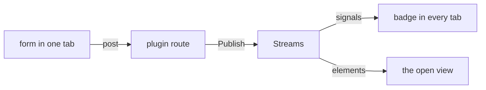

A plugin is a unit of behaviour Quire does not have: a basket, a search box, a comment thread.
It brings its own endpoints, styles and state, and a site opts in with one line.

## Using a plugin

```go
b := basket.New("/basket", items...)
site.AddPlugins(b)
site.AddLivePage("/basket", b.Page)
```

`AddPlugins` says the site has the plugin: its endpoints, its stylesheets and its control in the nav. It is a line in the site's blueprint like any other, and the plugin is attached only when the site is built to serve, never in a bake.

A plugin owns its endpoints, under `/_<name>/`, and no pages. A page that shows what it holds is a page the site adds, at an address the site chooses. Here the basket offers its page as `b.Page`, and is told where the site put it so its nav link leads there.

`examples/4-plugin` is a shop built this way.

## Search

Quire ships one plugin, in `plugin/search`: a search box in the nav whose results arrive as the visitor types.

```go
s := search.New("/search", searchui.Look())
s.Add(pages)
site.AddPlugins(s)
site.AddLivePage("/search", s.Page)
```

The plugin finds and does not draw. How its box and its results look is a `search.Look`, and `searchui.Look()`, from `pack/base/searchui`, is the default look's. A site with a look of its own hands in its own and keeps the search.

`Add` indexes a collection, one entry for each document's opening and one for each H2 and H3, held in memory. Call it for every collection the box should find.

An element marked `data-nosearch` is left out of the index, with everything inside it.
It is for a part of a page that is there to be looked at and would only crowd the results: a long listing, a generated table, a sample file.
The headings around it are still found, so the page is too.

```html
<details data-nosearch>
<summary>The whole file</summary>
...
</details>
```

[Lexis's languages](./languages.md) page marks each of its listings this way: search for a word that is only in one of them and it is not found, though the language's heading is.
In the box, `/` focuses it, up and down move through the results, and enter opens one.
Without JavaScript the form loads the results page instead, which is `s.Page`, at the address the site gave it.

## Writing a plugin

A `Plugin` is two methods:

```go
type Plugin interface {
  Name() string
  Attach(*Mount) error
}
```

`Name` is one word, and it is where the plugin lives: its routes are under `/_<name>/`, its CSS classes start `<name>-`, and its signals are `$<name>`.
`Attach` is called once and declares what the plugin adds:

```go
func (p *Plugin) Attach(m *plugin.Mount) error {
  p.mount = m
  p.streams = m.NewStreams()
  m.UseSessions()
  m.AddStylesheets(css, "basket.css")
  m.AddNavEnd(p.nav())
  m.Route("GET", "events", p.events)
  m.Route("POST", "add", p.add)
  return nil
}
```

`Attach` runs when the site is built to serve: after everything is declared, and before the stylesheet is made, so the plugin's assets reach it. A bake never runs it. So a plugin is made in the blueprint, where it can be handed collections, and does its work in `Attach`: anything slow, or outside the content, such as a connection.
The plugin API is package `plugin`, and a plugin imports it and `model`, never `quire`. One that draws with the default look's components imports `pack/base/ui` too, and is then tied to that look; one that takes its drawing as a parameter, as search does, is not.

A plugin holds its own state, embeds its own assets, and declares an interface for whatever the host must supply.
Lifting one into Quire is moving its file; nothing about how it is wired changes.

## What a plugin can do

`plugin.Mount` is the grant: the engine's doors and nothing else of it.
`go doc github.com/lahickey/quire/plugin.Mount` is the allow-list.

### Routes

- `m.Route(method, path, h)` is an endpoint under `/_basket/`. It is named from the plugin, so two plugins cannot pick the same namespace; `quire` and `site` are reserved. `m.URL(path)` is where it ended up.

### Pages

A plugin adds none. It offers one as a function the site can hand to `AddLivePage`: it is given the request and answers with the page's head data and its body.

```go
func (p *Plugin) Page(r *http.Request) (model.PageSpec, templ.Component) {
  return model.PageSpec{Title: "Basket", Path: p.at, NoIndex: true}, p.page(p.cart(plugin.Session(r)))
}
```

The site draws the document and the frame round the body, so a plugin's page is a site page like any other, and the body alone is what a stream patches.

### Forms

`@m.Form(path) { … }` is a form that posts to a route: a plain post without JavaScript, and a Datastar post that stays on the page with it.
End its handler with `plugin.Done(w, r)`, which answers either kind of caller: `204` to a live page, whose stream already carries the change, and a redirect for a plain form submission, back to the page it came from if that is on this site, otherwise to `/`.

### Live updates

- `m.NewStreams()` is Datastar SSE with a subscriber list.
- `Subscribe(w, r, topic, send)` is the whole handler: it opens a connection, sends the current state and holds it open.
- `Publish(topic, send)` reaches every connection on that topic, so a change made in one tab lands in all of them.
- `Signals(v)` marshals `v` and merges it into the page's signals under the plugin's name. The basket sends `{"count": 3}` and the page holds `$basket.count`, so two plugins cannot patch each other's.
- `Elements(ctx, component)` replaces the element with the same id.
- `m.Listen(path)` is the Datastar action that subscribes to a route: `data-init={ m.Listen("events") }`. Quire ships Datastar, so it owns the options too: a subscription reconnects for as long as the page is open and closes when its element is removed.
- `m.Signals(v)` is a `data-signals` value under the plugin's name, so a page starts with what `Stream.Signals` later patches: `data-signals={ m.Signals(map[string]int{"count": 0}) }`.

### Styles, scripts, nav and sessions

- `AddStylesheets` / `AddStylesheetsAt` go into the `plugin` cascade layer, so the site can restyle a plugin and never the reverse. `AddStylesheetsAt` is CSS for one step of the scale; Scale writes the query.
- `AddScripts` adds JavaScript files to `/_quire/quire.js`, each in its own function scope.
- `AddNavEnd(component)` is a control in the nav. A nil component fails the build.
- `UseSessions()` gives one `qsid` for every plugin, minted on navigation only. `plugin.Session(r)` reads it. Two cold tabs can race; last cookie wins. That is inherent to HTTP.

## CSS

The stylesheet is one sheet in four layers, `@layer base, plugin, pack, site`, which fixes precedence but not collision: two plugins both styling `.line` still clash.
So a plugin prefixes every class with its own name (`.basket-line`, not `.line`), and the build fails on a stylesheet with a class outside that prefix.

> [!IMPORTANT]
> Layers beat specificity, so a bare `button {}` in a site sheet outranks a plugin's `.basket-qty-btn`. A site that uses plugins should scope its element selectors.

## Per-visitor content on a cached page



A prepared page is one body for everyone, so it cannot carry a basket count.
It carries an empty badge instead, and a publish patches it per visitor.
The page stays immutable; only the patch differs.

## Datastar

Datastar is the small library Quire ships for live behaviour. A page declares what it wants in `data-*` attributes, and the server sends HTML or values over a stream.

### Syntax

Attribute syntax is `data-plugin:key`, colon not hyphen: `data-on:submit`, not `data-on-submit`.

> [!WARNING]
> A hyphen there does nothing at all and reports nothing. Keyless attributes (`data-text`, `data-signals`) work either way, which is what lets the mistake survive a casual test.

### Signals or elements

Choose the payload by what the audience can receive, and give each audience its own topic.
Signals are page-global and land wherever a tab happens to be, which suits a count in the nav.
Element patches need the element to exist, and Datastar warns `PatchElementsNoTargetsFound` otherwise, so a view-specific patch gets a topic only that view subscribes to.

### Where a subscription lives

Put a page-global subscription (a count, a badge) on chrome that is not swapped: a soft-nav replaces `main`, or a [region](./wiring.md#scripts) inside it, and nothing else.
A view-specific subscription lives on the view's own element, inside `main`, so leaving the page cancels it.

Two standing streams per tab stall HTTP/1.1 (six connections per host) at three tabs; a second stream only while that view is open does not. Production over TLS is HTTP/2 and multiplexes, so this bites in dev first and looks like the site hanging.
A hidden tab drops its stream and resubscribes on return.

### Push, always

Signalling a page so it turns around and fetches its own update is a round trip that should not exist.

## In depth

A publisher writes into another request's connection, so every write to a stream is serialised and carries a five-second deadline: one stalled reader cannot hold up the request that published to it.
A publish writes to all of a topic's streams at once.
An idle stream is sent a comment every 25 seconds, because proxies drop a silent connection.
