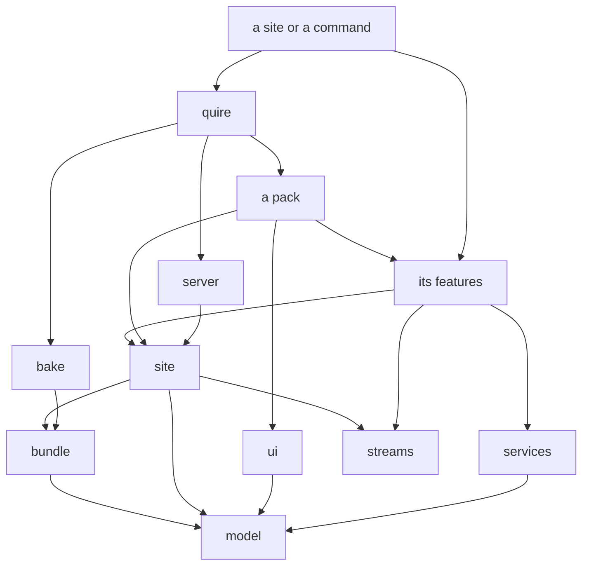

The other pages say how to use Quire. This one says why it is built the way it is.
You do not need it to build a site. Read it when a rule elsewhere seems arbitrary, or before changing Quire itself.

## The short version

- **A site is known by its features, not its folder.** One description of the site drives both the bake and the serving, so the two cannot disagree.
- **The bake converts and serving composes.** Everything slow happens once, ahead of time, and the binary that serves cannot convert at all.
- **Layers only point down.** The data knows nothing of the components, and the components nothing of the site built from them.
- **The look is tokens.** Sheets read roles and scale properties, never a hue or a pixel width.

## The words

Each word means one thing, in the code and in the docs.

The nouns:

- **Identity.** A site's name, base URL and description. Data only.
- **Feature.** Code that declares on a site: the documents it reads, its pages, routes, stylesheets and widgets. It only declares, so it runs in a bake as well as when serving, and it has no lifecycle. Several go into one site: the site's own, and those it includes.
- **Service.** Something that runs while a site is served and that others call: a store, sessions. It is started and stopped, and never sees the site.
- **Place.** Where a site is served: the root in front of its own addresses, and where the engine's are. The site does not know it.
- **Group.** A part of a site behind one gate, at the address of its name: `Admin` is `/admin`. Features add to it and the site gives it its gate. One with no gate is not served.
- **Core.** What cannot be removed: the site, the server, the baker's machinery and the bundle's format. It converts nothing and draws nothing by itself.
- **Source.** The requests a site makes for content: a document, a picture, the output of a converter. Everything below either answers them or asks them.
- **Baker.** A source that converts. It keeps the cache, the keys and the journal, runs the work and writes the bundle. It knows no formats: every conversion is a converter or a codec registered with it. It knows nothing of sites, routes or servers.
- **Bundle.** A journal and the files it names. It is a source that only reads.
- **Assets.** Stylesheets, scripts and fonts. They are embedded with the code, assembled and hashed at boot, and never baked.
- **Font set.** The fonts a site uses, chosen once: the faces a browser draws with, and how wide their characters are, for whatever lays text out in a bake. The share card draws with faces of its own.
- **Document.** One file of content, converted. It is not a page, which is an address, nor markdown, which is one format a document can come from. As a converter leaves it, it is a baked document: HTML with slots, its raw frontmatter and its headings.
- **Slot.** A place in a baked document that something goes: a picture, or a named fence. The bake fills the fences it can, and the site fills the rest when the page is composed.
- **Size.** How wide a picture is shown where it is placed: thumb, column, page, bleed.
- **Journal and record.** The index of a bundle, and one entry in it. Both are private to the baker and the bundle's reader. A record is what every baked thing has in common, with a payload for whatever its kind needs beyond that.
- **Master.** The file a picture is made from.
- **Picture.** A master and the ladder of variants made from it. "Image" is used only where somebody else's standard says it: the `` tag, markdown's syntax, `og:image`.
- **Mermaid.** A diagram written as mermaid, and the name of what converts and places it. "Diagram" is left free for charts and graphs, which are a separate thing to come.
- **Site.** Features run over a source: collections, pages, chrome, files and a table of routes. It is the table a feature declares on, and knows no server. Over an empty source it is a site with no bundle.
- **Server.** It holds entries, each a root, a bundle and a site, and owns the mux, the caches and the services' lifecycle.

Converter, codec, widget, service and pack are under their own headings below.

The verbs:

1. **Declare.** A feature says what the site contains. It is the same call in a bake and when serving.
2. **Collect.** Run the features over a baker, so the site asks for what it needs.
3. **Bake.** The baker converts and journals, then writes the bundle of what was referred to.
4. **Build.** Run the features over a bundle, which makes the site.
5. **Mount.** Put a site at a root, in a server or in a mux that is somebody else's. The word means nothing else.
6. **Serve.** The server answers requests for the sites it holds.

```
features + baker   --bake-->   bundle
features + bundle  --build-->  site
site               --mount-->  a server, or a mux of your own
```

Collecting links the site's Go, because a feature reads its documents while it declares.
So bake and serve are separate packages and phases, not programs that never meet.
A CMS skips collecting and makes the baker's requests from its own logic.

## One description

Bake and serve run the same features. The folder is not a second answer to what the site contains. A file reaches the bundle because a feature read it or referred to it. `AddFile` ships anything else.

Dev may run a step lazily. It may not skip one. A variant is in a journal or it is an error, in every mode.

A bake reads the source tree. What that run renders is thrown away: source order is the measured bytes, and those exist only after the encode.

A bake has no server. The routes and pages a feature declares are written down and never served, and nothing is ever started, so what a handler opens is never opened in a bake.
A site is described once, and that one description is collected over a baker and built over a bundle, so the two cannot be handed different things.

The bake converts and serving composes. Markdown, masters and mermaid are converted once, by the bake; a template places what came out. A document reaches the bundle as HTML with a slot for each picture and each named fence. A fence's slot holds the code block it is when nothing claims it, and serving decides what goes there: a widget of that name, or the code block. A picture's is filled from the journal, with whatever markup the site's look gives it. So a change to the scale, to `ui` or to a widget needs no rebake, and one master referred to twice is one slot.
The bake is never told which fences a site has widgets for. A widget named for a language is found when the site is built, because that fence arrives already filled, and it is an error and not a silent choice between the two.

Everything the bake makes is one kind of thing: a journal record, keyed by what it was made from, naming content-addressed files. A record is what every baked thing has in common: its name, its kind, its key and its files. Whatever one kind needs beyond that is a payload only a reader of that kind understands; a picture's is its master and the width of each file. A document, a mermaid diagram and a share card are each one file; a master is its ladder. One check decides what is remade, one copy decides what ships, and one lookup finds it again.

The baker knows no formats. It keeps the cache, the keys and the journal, and is handed what converts: a converter, which turns an input into one file, and a codec, which opens a master once and gives any number of rungs.
Markdown, mermaid and the share card are converters and the picture codec writes WebP, each a package of its own, so a bake links only what it is handed.
What a site asks of a bake and of a bundle is the same few requests, and each carries everything its output depends on.

Something that must convert per request is a feature that imports its converter.

## Journal

A journal is an authority. One that will not write fails the build. It is written whole and renamed into place. A variant is one content-addressed file, so a crash leaves it whole or absent.

The bundle is linked from the cache. Nothing edits a bundle file in place.

A key holds everything its output depends on: the input, the settings, and the converter's version. Each converter states its own version, which changes by hand, so a refactor rebuilds nothing; a release check fails on any converter whose code or dependencies moved since its version was set.

`site` and `server` do not import the baker, so a program that serves with them cannot convert: no codec, no markdown, no highlighter.
`Run` bakes and serves in one program, so `quire_nobake` swaps its bake half for a stub.
Where the bundle lives is a separate choice. The bake writes `.quire/ship.go`, which embeds the bundle and hands it to `Ship`; a build adds that file with `-overlay .quire/ship.json`, and without it the bundle is read off disk. A shipped static site uses the tag and the overlay, a CMS uses neither, and a binary built with the tag alone serves a bundle kept beside it.

## Packages

Layers only point down, and a test holds them to it.



`model` is the data, and imports nothing of Quire's but the colour scales. It holds the two structures a converter makes and a site reads: a baked document and a picture.
`bundle` opens what a bake left, over any `fs.FS`, and is otherwise opaque. The journal and its records are private to it and the baker.
`streams`, under `libs/`, is live updates over Datastar, and imports nothing of Quire's. `ui`, the default look's components, imports `model` and nothing else, and is part of the base pack.
`site` is the table a feature declares on. It knows no feature and no server, and imports no component: the look reaches a site only through what a pack sets on it.
`server` serves a site, and `bake` is the baker. Neither imports the other.
`quire`, the root, is the helpers over all of them, `Run` among them. It is the top of the tree, and only a site or a command imports it.

The bake side has the same shape: a converter imports the baker, and the baker imports the bundle and the model.

A helper is one function for a common pattern, such as a content folder baked and served as a blog.
Helpers call only what is public, and are where the smallest site stays small.
Nothing in the parts calls a helper, and a site is free to compose the parts itself.

`quire.Run` is the site engine in one binary: it bakes, builds and serves.
`Collect` and `Build` are not helpers. They are the verbs, and the only way a site is made.

The parts need no build tag. A program with its own bake program never links a codec into what it ships.
`quire_nobake` lives on inside the helpers only, to stub the bake half of `Run` for a site that wants one `main`.
A serving `main` written by hand against the parts is about six lines, and earns a helper when something needs it.

## Features

A feature is the one way to add to a site.

```go
type Feature interface {
    Name() string
    Declare(*Site) error
}
```

- **The site runs each feature**, so it knows whose turn it is and can hold a feature to its name.
- **A named feature has a namespace of its own.** Its routes are under `/_name/`, its classes begin `name-`, and its streams are scoped by the name. The site refuses anything outside it.
- **A feature with no name works in the site's namespace.** It adds pages, plain routes, stylesheets, widgets and the frame, and cannot have what needs a scope. The site's own is one, and so are base and docs, which are a site's look.
- **The site's own word wins.** What it sets is never replaced by a feature it includes, whichever spoke first.
- **It only declares.** A bake runs every feature and serves nothing, so whatever a feature does in a handler cannot happen in a bake.
- **It is handed what it needs** by its constructor: its settings and its services.
- **It is included per site.** One value included in several sites shares whatever state it keeps.
- **It has no lifecycle.** A feature that needs something running is handed a service that runs it.

Streams are a library, not a feature: a feature that updates a page live makes one and publishes to it.

What a feature declares may have a half that runs in a bake, under the same name.

| Role | Runs | Does |
|-|-|-|
| Converter | at bake | bytes and settings in, one file out |
| Codec | at bake | opens an input once, answers many requests |
| Widget | at page render | places output in the page |
| Route | while serving | answers a request, opens a stream |

- The name is what joins the half that bakes to the half that renders.
- They are registered apart because they are linked apart: what converts is heavy and stays out of a serving binary, and what a feature declares is light and is in it.
- A converter or a codec sits in a package of its own, so a serving binary that imports the feature does not link it.
- A converter has a version of its own, in the key of everything it makes.
- A codec is for what is costly to open: a picture decoded once for every rung, a video opened once for every frame.
- A document converter claims a file extension, so markdown is one way to a document and not the only one.
- Core defines the few structures it reads, and does not know what made or will render them. A **document** is one, since collections are built from it. A **picture** is one, widths and the file for each, since sizes and the scale are core's layout. Both are in `model`, and nothing else of a bundle's insides is public.
- Anything else a converter makes is one file that only its widget understands. Mermaid's is an SVG its widget inlines, and charts will likely be the same.
- A live chart is one feature that sets a widget and adds a route, with its converter beside it.

## Services

A service is a plain value that runs while a site is served: a store, sessions, a mailer.
It has a lifecycle and never sees the site, where a feature declares and has none.
Nothing is both.

```go
type Service interface {
    Start(context.Context, model.Env) error
    Stop(context.Context) error
}
```

A site makes its services, adds them, and hands them to what uses them.

```go
carts, visitors := store.NewMemory(), sessions.New()
s.AddServices(carts, visitors)
s.Include(basket.New(carts, visitors, "/basket", items...))
```

- **Handed over by constructor.** A feature, another service or the site's own handler takes what it needs as an argument, typed by what it needs. A missing one does not compile, a test passes a fake, and nothing is looked up by name or by type.
- **Every service is added**, whether or not it has anything to start yet, so one that grows a lifecycle later changes no site. The site lists them for the server, which starts them in the order they were added and stops them in reverse.
- **A constructor only stores its arguments.** Connections and goroutines are opened in `Start`. A bake never calls `Start`, so only the constructor is left to convention.
- **`Start` is told the environment**, `model.Env`: the site's identity, whether it is in dev, and its logger. What is fixed for the life of the site is settled there, once, and never worked out for a request. `Env` can grow without the interface changing.
- **A feature that scopes its data does it itself**, with `store.Under(st, "basket")`, so every feature is handed the same store.
- **The site chooses what is behind an interface**: a store in memory for a test, SQLite for a small site, the site's own for anything else.
- **A heavy implementation is a package of its own**, so a site links only the one it chose.

The standard ones are a store and sessions.
Sessions are who the visitor is, and features ask: a visitor is given a cookie the first time something asks.
A logger is not a service: it is a `*slog.Logger`, in the environment for a service and from the site for a feature.
Others, such as mail, take the same shape as the store.

## Groups

A group is a root and a gate.

- **Typed, not spelt.** `site.Members` and `site.Admin` are constants, and a site's own group is one more.
- **Features add to it** with `s.In(site.Admin)`, at `/admin/<feature>/`, so every feature's admin pages sit together behind one gateway.
- **The site gives it its gate**, a wrapper round every handler in it. Authorisation is the gate's: "has a token" for members, "has a token with the admin flag" for admin. Quire knows nothing of tokens.
- **Safe by default.** A group with no gate is not served, and nothing else may be added under a served group's root.
- **Nothing in a group is kept.** The page cache sits in front of every gate, so a group has no shared route.

A named feature's `/_name/` and the site's `/` are the same idea with no gate, and rooting a site at a path is giving `/` a root.
Quire ships no gate. A site brings its own, as `examples/4-shop` does with a password.

## Packs and the look

A pack provides any number of features, services, converters, components, stylesheets, fonts and palettes.
It is how they are shipped together, and not a mechanism of its own.
Changes to the base colour system are a pack's to make too.
A pack may bring features of its own, as `pack/docs` does for documentation.

Quire ships two. **Base** holds every default: markdown, the WebP codec, mermaid, the share card, the default look and its components, and the default font files and palettes. **Docs** rests on base, and is a documentation site's pages.
Search, sessions and a store are mechanisms, not look: each stays outside base, and base brings only how search is drawn.
Each is a package of its own inside it.
Without base Quire is naked: it serves what a program declares and converts nothing, and a site has a correct document and nothing else.
`Run` puts base beneath every site, and `examples/1-site` is the proof.

Base is written against the interfaces any other pack uses, and a test holds it to it.
Turning something off is not registering it, never a flag: what is not imported is not linked.
A helper gives a site the standard set, so the smallest site stays as small as it is.

A look's vocabulary is the site's: the palette and its default, the theme, the palette picker, the scale and what the share card says, each an option.
They are data that any look reads, as it reads the navigation and the footer's links, and they are options because they have to be settled before a feature runs.
How any of it is drawn is a pack's, and none of that is in `site`.

A feature with no look is handed one. Search is handed its box and its results, and the feature that makes a site from the content folder is handed how a page, a listing and a document are drawn. The base pack does the handing for the default look, and a pack may bring features of its own.

Quire ships a class only if it ships the rules for it.

What base weighs in a binary is mostly its fonts, then Datastar, which base asks for on every page because its theme toggle and copy buttons are written with it.

## Scale

The column is 336 because that is the widest one that still fits two of them on a 744px tablet, the narrowest worth keeping off the phone layout.

How wide a picture goes is where it is placed, so one wide page does not make every thumbnail pay for that width.

`sizes` sees the viewport, not the container. Between the two-column width and the three-column width a `.page` is already capped and a `.page--wide` is still growing, so the cells differ in that band.

`SizeBleed` measures in `cqw` against `main`. `100vw` counts the scrollbar.

A sheet reads the scale's variables and never writes a width query. `AddStylesheetsAt` attaches CSS to a step.

`--qr-measure-text` is `ch`, because a comfortable line belongs to the font. `.prose` is a breakout grid so a figure is not capped with the text.

Every custom property is `--qr-*`. A named feature uses its own prefix. Overriding a `--qr-*` token is a tweak, the same act as `WithScale`.

## Colour, fonts, diagrams

A palette is roles. Sheets read the role, never a hue, and do not mix tints. The scales are Radix, because the light and dark pairs are already tuned. A test holds text contrast.

A browser face is woff2. A diagram is laid out in the bake, where there is no browser, so a font set carries how wide its characters are, read once from a TTF by `quire fonts`. The site hands the set to the converter, and no bake needs a font file to measure with. The share card is different: it draws glyphs, so it has two TTF faces of its own, and they need not be the site's. Quire writes `--qr-font` and `--qr-font-mono`.
The font files are the base pack's, and the machinery is `site`'s: reading a set's description, writing its rules, preloading and serving. A site with no font set draws in the system's.

Mermaid is the diagram format editors already preview. The renderer is heavy, so it lives on the bake side. A diagram is inlined so it can see the page's custom properties. The site asks for it by its source and the font set, so it is laid out for the fonts the site serves.

## Pages

A page is its head data and a body, and the site wraps it: the document round the frame round the body.
A body does not draw the document it sits in. So the same body is a whole page when a visitor asks for it and a patch when a stream sends it, and a site with a look and one without differ by one setting and not by every template.

The document, with a correct head, is the site's. The frame, a header and a footer, is the look's, and a pack sets it.
What a body needs of the site it reads from its render's context: the scale a picture is shown at, the date layouts, the navigation. Nothing is handed through a template to reach something further in.

The same rule runs through the model: a value holds what it uses.
A collection is its documents, and holds neither the site's identity nor its pages.
A picture is a master and its files, and how wide it is shown is the scale's to answer.
The chrome is data, and holds no function that draws it.

## Serving

A site is features run over a source, and has no server in it. Its routes are a table.
The server makes a mux from the table and adds what claims the whole address space: the not-found page for every other path, `robots.txt`, the sitemap, the health check and the `www` redirect.
So a host that serves a site some other way is bound by none of those.
A site's own files are not among them: its pictures are routes in its table, under `/_quire/`, so they go wherever the site is mounted.

What fails while a site is built is returned, not panicked: a route two patterns contend for, a file that will not read, a page that will not render.

What happens to a response follows the response, not the mode.

A fixed page is rendered once when the site is built. A collection item is cached under its path and coding, and so is a route that asks to be shared. Anything else goes straight to its handler. The cache key has no method and no cookie, so a stored body is the same for every visitor.

Building closes the site. A route added after it panics.

### Several sites

A site writes its addresses as if it were at `/`, and a place says where it is served: a root for its pages, features and groups, and where the engine's `/_quire/` is.
The place is applied only at the edges, to the route table coming in and to what is sent going out, so a site, a feature and a template never mention it.
A placed site can be mounted in somebody else's server, beside routes Quire does not manage, or sit behind a proxy at a path.

A server holds any number of placed sites, each with its own bundle, and the first is the box's own.
Everything Quire serves for itself is under `/_quire/`, each site in a part of its own.
"Several sites" is nothing more than several places: the documentation with its examples under `/examples/`, or a box of tenants.
The operator's level is the site at `/` and its `Admin` group; a tenant's is its own.

### Inside another program

A program with a web layer of its own uses Quire for as much as it wants and no more.

- **A whole site at a root.** Its documentation, built from a bundle and mounted in its own mux, with no server of Quire's.
- **Its own pages from the pieces.** The document, the frame and the components, the assembled stylesheet, hashed URLs and their cache headers, live reload, sessions and streams, each a handler or a wrapper it can take alone.
- **Nothing baked.** A site whose pages are all Go has no bundle, and its assets are still embedded and served.
