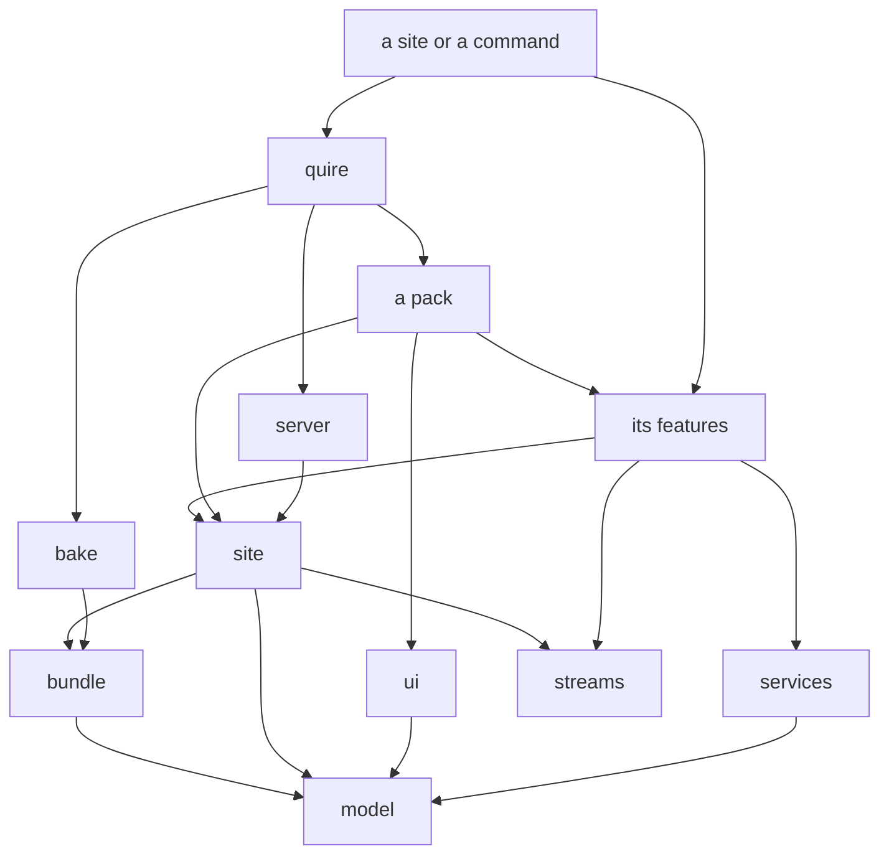

The other pages say how to use Quire. This one says why it is built the way it is.
You do not need it to build a site. Read it when a rule elsewhere seems arbitrary, or before changing Quire itself.

## The short version

- **A site is known by its features, not its folder.** One description of the site drives both the bake and the serving, so the two cannot disagree.
- **The bake converts and serving composes.** Everything slow happens once, ahead of time, and the binary that serves cannot convert at all.
- **Layers only point down.** The data knows nothing of the components, and the components nothing of the site built from them.
- **The look is tokens.** Sheets read roles and scale properties, never a hue or a pixel width.

## One description

Bake and serve run the same features. The folder is not a second answer to what the site contains. A file reaches the bundle because a feature read it or referred to it. `AddFile` ships anything else.

Dev may run a step lazily. It may not skip one. A variant is in a journal or it is an error, in every mode.

A bake reads the source tree. What that run renders is thrown away: source order is the measured bytes, and those exist only after the encode.

A bake has no server. The routes and pages a feature declares are written down and never served, and nothing is ever started, so what a handler opens is never opened in a bake.
A site is described once, and that one description is collected over a baker and built over a bundle, so the two cannot be handed different things.

The bake converts and serving composes. Markdown, masters and mermaid are converted once, by the bake; a template places what came out. A document reaches the bundle as HTML with a slot for each picture and each named fence. A fence's slot holds the code block it is when nothing claims it, and serving decides what goes there: a widget of that name, or the code block. A picture's is filled from the journal, with whatever markup the site's look gives it. So a change to the scale, to `ui` or to a widget needs no rebake, and one master referred to twice is one slot.
The bake is never told which fences a site has widgets for. A widget named for a language is found when the site is built, because that fence arrives already filled, and it is an error and not a silent choice between the two.

Everything the bake makes is one kind of thing: a journal record, keyed by what it was made from, naming content-addressed files. A record is what every baked thing has in common: its name, its kind, its key and its files. Whatever one kind needs beyond that is a payload only a reader of that kind understands; a picture's is its master and the width of each file. A document, a mermaid diagram and a share card are each one file; a master is its ladder. One check decides what is remade, one copy decides what ships, and one lookup finds it again.

The baker knows no formats. It keeps the cache, the keys and the journal, and is handed what converts: a converter, which turns an input into one file, and a codec, which opens a master once and gives any number of rungs.
Markdown, mermaid and the share card are converters and the picture codec writes WebP, each a package of its own, so a bake links only what it is handed.
What a site asks of a bake and of a bundle is the same few requests, and each carries everything its output depends on.

Something that must convert per request is a feature that imports its converter.

## Journal

A journal is an authority. One that will not write fails the build. It is written whole and renamed into place. A variant is one content-addressed file, so a crash leaves it whole or absent.

The bundle is linked from the cache. Nothing edits a bundle file in place.

A key holds everything its output depends on: the input, the settings, and the converter's version. Each converter states its own version, which changes by hand, so a refactor rebuilds nothing; a release check fails on any converter whose code or dependencies moved since its version was set.

`site` and `server` do not import the baker, so a program that serves with them cannot convert: no codec, no markdown, no highlighter.
`Run` bakes and serves in one program, so `quire_nobake` swaps its bake half for a stub.
Where the bundle lives is a separate choice. The bake writes `.quire/ship.go`, which embeds the bundle and hands it to `Ship`; a build adds that file with `-overlay .quire/ship.json`, and without it the bundle is read off disk. A shipped static site uses the tag and the overlay, a CMS uses neither, and a binary built with the tag alone serves a bundle kept beside it.

## Packages

Layers only point down, and a test holds them to it.

`model` is the data, and imports nothing of Quire's but the colour scales. It holds the two structures a converter makes and a site reads: a baked document and a picture.
`bundle` opens what a bake left, over any `fs.FS`, and is otherwise opaque. The journal and its records are private to it and the baker.
`streams`, under `libs/`, is live updates over Datastar, and imports nothing of Quire's. `ui`, the default look's components, imports `model` and nothing else, and is part of the base pack.
`site` is the table a feature declares on. It knows no feature and no server, and imports no component: the look reaches a site only through what a pack sets on it.
`server` serves a site, and `bake` is the baker. Neither imports the other.
`quire`, the root, is the helpers over all of them, `Run` among them. It is the top of the tree, and only a site or a command imports it.

A feature is the one way to add to a site. The site runs each one, so it knows whose turn it is, and holds one with a name to its own namespace: its routes, its classes, its signals. A feature Quire ships is a package under `feature/`, written against the same `site` as any other.

A service is something features call, and never sees the site: it imports `model` and nothing above it. The site lists its services and the server starts and stops them, so a bake, which has no server, starts none.

A pack sits above `site`: it is a feature with no name that somebody else wrote, and a site hands it to `Run` or includes it in its own. A site and its packs say things the same way, and what the site says is never overruled by a pack, whichever spoke first. A pack Quire ships is a package under `pack/`, and it calls nothing a site could not.

## Scale

The column is 336 because that is the widest one that still fits two of them on a 744px tablet, the narrowest worth keeping off the phone layout.

How wide a picture goes is where it is placed, so one wide page does not make every thumbnail pay for that width.

`sizes` sees the viewport, not the container. Between the two-column width and the three-column width a `.page` is already capped and a `.page--wide` is still growing, so the cells differ in that band.

`SizeBleed` measures in `cqw` against `main`. `100vw` counts the scrollbar.

A sheet reads the scale's variables and never writes a width query. `AddStylesheetsAt` attaches CSS to a step.

`--qr-measure-text` is `ch`, because a comfortable line belongs to the font. `.prose` is a breakout grid so a figure is not capped with the text.

Every custom property is `--qr-*`. A named feature uses its own prefix. Overriding a `--qr-*` token is a tweak, the same act as `WithScale`.

## Colour, fonts, diagrams

A palette is roles. Sheets read the role, never a hue, and do not mix tints. The scales are Radix, because the light and dark pairs are already tuned. A test holds text contrast.

A browser face is woff2. A diagram is laid out in the bake, where there is no browser, so a font set carries how wide its characters are, read once from a TTF by `quire fonts`. The site hands the set to the converter, and no bake needs a font file to measure with. The share card is different: it draws glyphs, so it has two TTF faces of its own, and they need not be the site's. Quire writes `--qr-font` and `--qr-font-mono`.
The font files are the base pack's, and the machinery is `site`'s: reading a set's description, writing its rules, preloading and serving. A site with no font set draws in the system's.

Mermaid is the diagram format editors already preview. The renderer is heavy, so it lives on the bake side. A diagram is inlined so it can see the page's custom properties. The site asks for it by its source and the font set, so it is laid out for the fonts the site serves.

## Layers

A look's vocabulary is the site's: the palette and its default, the theme, the palette picker, the scale and what the share card says, each an option.
They are data that any look reads, as it reads the navigation and the footer's links, and they are options because they have to be settled before a feature runs.
How any of it is drawn is a pack's, and none of that is in `site`.

A feature with no look is handed one. Search is handed its box and its results, and the feature that makes a site from the content folder is handed how a page, a listing and a document are drawn. The base pack does the handing for the default look, and a pack may bring features of its own.

The default look is the base pack, and nothing of it is in `site`: its components, its stylesheets and scripts, its fonts, its frame, its pages and its widgets. `Run` puts it beneath every site, and `examples/1-minimal` is the proof. A site built without it has a correct document and nothing else. A site is not a pack.

Quire ships a class only if it ships the rules for it.

## Pages

A page is its head data and a body, and the site wraps it: the document round the frame round the body.
A body does not draw the document it sits in. So the same body is a whole page when a visitor asks for it and a patch when a stream sends it, and a site with a look and one without differ by one setting and not by every template.

The document, with a correct head, is the site's. The frame, a header and a footer, is the look's, and a pack sets it.
What a body needs of the site it reads from its render's context: the scale a picture is shown at, the date layouts, the navigation. Nothing is handed through a template to reach something further in.

The same rule runs through the model: a value holds what it uses.
A collection is its documents, and holds neither the site's identity nor its pages.
A picture is a master and its files, and how wide it is shown is the scale's to answer.
The chrome is data, and holds no function that draws it.

## Serving

A site is features run over a source, and has no server in it. Its routes are a table.
The server makes a mux from the table and adds what claims the whole address space: the not-found page for every other path, `robots.txt`, the sitemap, the health check and the `www` redirect.
So a host that serves a site some other way is bound by none of those.
A site's own files are not among them: its pictures are routes in its table, under `/_quire/`, so they go wherever the site is mounted.

What fails while a site is built is returned, not panicked: a route two patterns contend for, a file that will not read, a page that will not render.

What happens to a response follows the response, not the mode.

A fixed page is rendered once when the site is built. A collection item is cached under its path and coding, and so is a route that asks to be shared. Anything else goes straight to its handler. The cache key has no method and no cookie, so a stored body is the same for every visitor.

Building closes the site. A route added after it panics.
