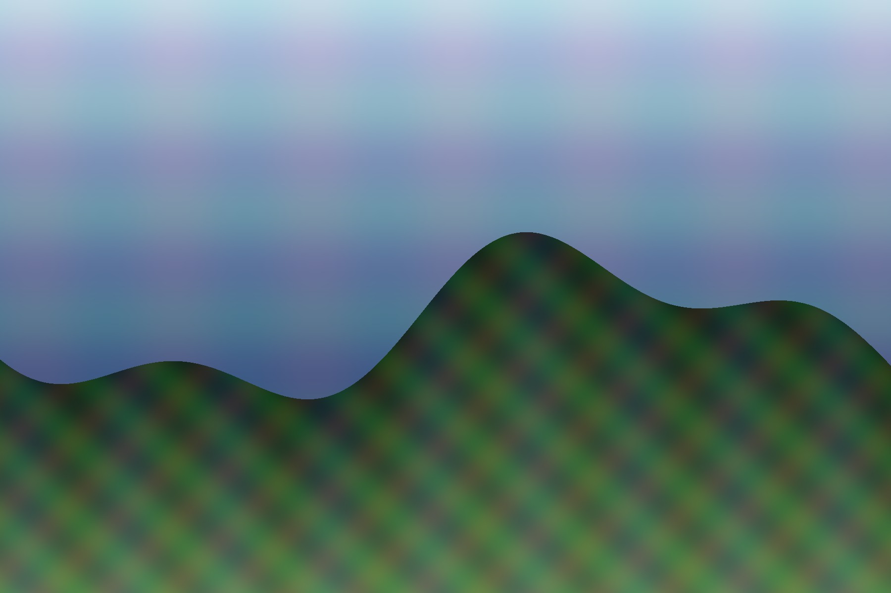
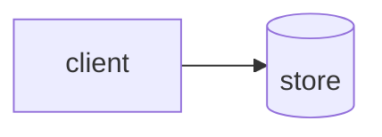
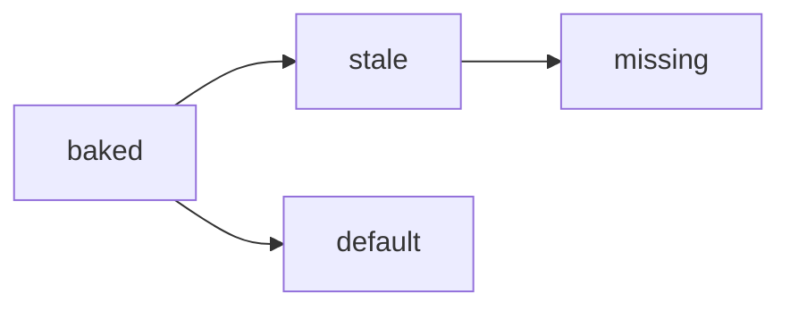

A site's words live in a `content` folder, as markdown files.
The site groups them into collections, and each collection gets an index page and a page per document.

## A document

A document is YAML frontmatter between `---` fences, then a markdown body.

```markdown
---
title: Tags that know what they are
date: 2026-02-01
summary: A classifier turns free-text tags into kinds.
tag: [Go, Design]
---

The body starts here.
```

The file's name is its address: `content/posts/hello.md` is served at `/posts/hello`.

## A site from the folder

`base.Content()` makes a whole site from the content folder, with no Go beyond the call:

```go
quire.Run(model.Identity{Name: "Example", BaseURL: "https://example.com"}, base.Content())
```

| In `content/` | Becomes |
|-|-|
| `index.md` | The home page |
| `about.md` | A page at `/about` |
| `posts/` | A listing at `/posts`, and a page for each file |
| `posts/index.md` | The collection's title and summary |

- Each page and each folder is in the navigation. `nav` in `index.md` puts them in order, and whatever it leaves out follows in alphabetical order:

  ```yaml
  title: Example
  nav: [posts, about]
  ```

- A name in `nav` that is neither a page nor a folder fails the build.
- A folder with no documents, as when every one is a draft, has no pages and is not in the navigation.
- With no `index.md` the home page is the default one: the site's name, its description and its sections.
- A folder with no markdown in it, such as one of pictures, is left alone.
- `index.md` is never a document of a collection, here or in one a site adds itself.

`examples/1-site` is a site made this way.

It is the feature `content.Pages`, from `feature/content`, handed the default look's drawings: `ui.Page`, `ui.Listing` and `ui.Article`.
A site with another look hands it its own:

```go
s.Include(content.Pages{Page: page, Listing: listing, Document: article})
```

A site that wants pages of its own for a collection does not use it, and adds its collections as below.

## Frontmatter

The stock fields are `model.Meta`:

- `title`: the page title.
- `summary`: one line, shown in listings and used as the page description.
- `date` and `updated`: ISO dates, `YYYY-MM-DD`.
- `picture`: a picture beside the document. See [Pictures](#pictures).
- `tag`: a YAML list, `tag: [Go, NATS]`.
- `draft`: leaves the document out unless the site runs with `--drafts`.
- `featured`: marks the document so a page can select and badge it.
- `aliases`: other addresses that redirect here. See [Aliases](#aliases).
- `links`: a list of `label` and `url`, shown as buttons under the title. See [A blog](./blog.md#the-posts-page).
- `extra`: [fields of your own](#fields-of-your-own).

An unknown key is a load error, so a typo cannot pass silently.
A `---` in the body is an ordinary rule.

### Fields of your own

Anything a site or a feature keeps in a document beyond the stock fields goes under `extra`:

```yaml
title: Paper Moon
picture: paper-moon.jpg
extra:
  medium: Screenprint on Somerset, 50 × 62 cm
```

`d.Meta.Extra` is that map, and `d.Meta.Text("medium")` is one of its values when it is a string.
`examples/4-shop` shows a print's medium that way, and reads its price into a type of its own.

Fields with more shape than a string are read into a type of the site's own, once, when the site is built:

```go
type Product struct {
  Status string       `yaml:"status"`
  Links  []model.Link `yaml:"links"`
}

products, err := s.Collection(model.Spec{ID: "products"})
extra, err := products.Extra[Product]() // by slug: extra[d.Slug].Links
```

A key under `extra` that the type does not have fails the build, as an unknown stock key does.

### Dates

Dates are parsed once at load into `Date`. Anything that is not ISO fails the build, so a bad date never reaches a page.
`Identity.Dates` is the layouts dates render in, day first by default, and `ui.LongDate`, `ui.ShortDate` and `ui.MonthYear` format a `Date` to it for the site a page belongs to.
`Date.ISO()` is the machine form. The sitemap and the dates in a page's head always use it.
A custom formatter takes a parsed `Date`, so it only formats.

### Drafts, featured and other state

`draft` and `featured` are the two states Quire acts on. Drafts are filtered from the build and the sitemap unless `WithDrafts`. Featured is only ever selected and badged.
Anything else a document says about its own state is the site's vocabulary: give the collection's spec a `Badges` function, from a document to its markers, and Quire renders what it is handed, knowing none of the words.

### Aliases

A document that moves keeps its old address by naming it:

```yaml
aliases: [/writing/quire]
```

Each alias answers with a permanent redirect to the document, wherever the document now lives.
This page names `/docs/frontmatter`, so [/docs/frontmatter](/docs/frontmatter) lands here.
An alias that is already a page or a document, or that two documents both name, is a load error.

## Markdown

The body is standard markdown, with these additions.

### Pictures

`` is a picture. The path is relative to the document, like a link (`archr/columns.png`), or from the content root when it starts with `/`.
A picture in a paragraph of its own becomes a `.figure`; one inside a sentence stays an inline ``.
A figure's text is both its caption and its alt text, as in Pandoc. Write `` when the two should differ.
An `http(s):` picture is left alone, and a missing file fails the load.

This line:

```markdown

```

is this figure:


The frontmatter `picture` resolves the same way. The default look renders it as a listing thumbnail, an article hero and the share image, with no CSS of your own. [A blog](./blog.md) shows all three, and [Pictures](./pictures.md) covers how a picture is encoded and served.

### Code

A fenced code block is highlighted, and gets a copy button that shows on hover.

~~~markdown
```go
// Greet says hello.
func Greet(name string) string {
  return "Hello, " + name
}
```
~~~

```go
// Greet says hello.
func Greet(name string) string {
  return "Hello, " + name
}
```

The word after the fence names the language, and [Lexis](./lexis.md#languages) lists those Quire has.
A fence with no language, or one Quire does not have, is shown plain.
[The look](./look.md#code) has the classes that colour it.

### Tables

A pipe table is a table. A wide one scrolls sideways rather than widening the page.

| Field | Does |
|-|-|
| `draft` | Leaves the document out unless `--drafts` |
| `featured` | Marks it to be selected and badged |

### Headings

Every heading gets an id, and a link that shows on hover so a reader can copy the address of a section.
The table of contents on a page lists H2 and H3.

### Links between documents

Link to another document by its file: `[Baking](./bake.md)` or `[one](../posts/one.md#part)`.
The link is written as the address of that document's page, so the same markdown works on a forge and on the site.

### Diagrams

A fence named `mermaid` is a diagram.

````markdown

````


It is drawn by the bake and inlined as SVG, so the palette and the fonts reach it.
Nodes take a light tint of the accent. `class n tone2` or `n:::tone2` tints one with any role (`accent` `spot` `tone1`…`6` `ok` `warn` `error`), and a forge's preview just ignores the class.

````markdown

````


A diagram the bundle does not hold fails the load.

### Cards

A `cards` fence is a grid of cards, each a link. Its body is a YAML list.

````markdown
```cards
- href: /docs/pictures
  kicker: Pictures
  title: Pictures, end to end
  description: From a picture beside a document to a responsive ladder.
- href: /docs/look
  kicker: The look
  title: Good by default
  description: Palette, fonts and a light and dark toggle.
```
````

```cards
- href: /docs/pictures
  kicker: Pictures
  title: Pictures, end to end
  description: From a picture beside a document to a responsive ladder.
- href: /docs/look
  kicker: The look
  title: Good by default
  description: Palette, fonts and a light and dark toggle.
```

`kicker`, `description` and `cta` are optional, and a field of any other name fails the load.
The grid is as wide as the page, not the text.

### Callouts

A blockquote that opens with one of GitHub's markers renders as a `.callout`:

```markdown
> [!WARNING]
> Mind the gap.
```

> [!WARNING]
> Mind the gap.

The markers are `[!NOTE]`, `[!TIP]`, `[!IMPORTANT]`, `[!WARNING]` and `[!CAUTION]`. Each has its own colour and label:

> [!NOTE]
> Something worth knowing in passing.

> [!TIP]
> A better way to do it.

> [!IMPORTANT]
> What the reader must not miss.

> [!CAUTION]
> What goes wrong if they do.

Any other blockquote is still a quote:

> A plain blockquote, with no marker.

### Styled spans

`[text]{.class}` is a span with those classes, Pandoc's bracketed span. It styles a few characters with the site's CSS without writing HTML. The text is literal and the braces take classes only.

```markdown
Released today. [New]{.kicker}
```

Released today. [New]{.kicker}

`.kicker` is one of Quire's own classes. A class of the site's needs a rule in the site's stylesheet.

### Raw HTML

Raw HTML in the body is rendered as it is, because the markdown is the site's own.

## Widgets

A widget turns a named fence into HTML of the site's choosing.
`s.SetWidget` gives a fence's name a `Widget`, which is handed the rest of the fence's first line and its body.

```go
func swatch(_, body string) (string, error) {
  return `<p class="swatch">` + strings.TrimSpace(body) + `</p>`, nil
}

s.SetWidget("swatch", swatch)
```

A fence named `swatch` in any of the site's documents now renders as the chip.
This site has that widget, and a rule for `.swatch` in its stylesheet:

````markdown
```swatch
ember
```
````

```swatch
ember
```

`palette` is built in:

````markdown
```palette
accent spot tone1 tone2 ok warn error
```
````

```palette
accent spot tone1 tone2 ok warn error
```

- `mermaid`, `cards` and `palette` are widgets the base pack brings, and a site's widget of one of those names replaces it. `palette` draws each role it names from the page's own custom properties: a range (`neutral`, `accent`) as a row of its twelve steps, and the rest side by side with a row for each of their four. The word `all` is every role.
- A name after `palette` draws that palette whatever the visitor has picked, if it is one the site's [picker](./look.md#let-the-visitor-choose) offers: `palette moss`.
- A fence shown inside a longer fence stays code, so a page can show a widget's syntax without running it.
- A widget runs when the page is composed, not in the bake, so changing or adding one needs no rebake. The bake records where each named fence sits and what was in it.
- A widget cannot take the name of a language Quire highlights, such as `go`. The bake has already made that fence code, so the site fails to load and says which fence. Rename the widget.
- A fence whose name is neither a language nor a widget is shown as plain code.
- A widget is added before any content is read. One added after a document was read fails the load.
- A pack adds a widget the same way, and the site's own wins over a pack's of the same name, whichever came first.
- A widget that returns an error fails the load, the same as bad frontmatter.

## Collections

`Collection` loads the documents matching a glob. A collection is its documents and nothing else: it has no pages until something draws them.

```go
notes, err := s.Collection(model.Spec{ID: "writing", Title: "Writing"})
if err != nil {
  return err
}
base.Pages(s, notes)
```

The first call reads `content/writing/*.md`.
`base.Pages`, from `pack/base`, gives the collection the default look's two pages: a listing at `/writing`, which goes in the navigation, and an article at `/writing/{slug}` for each document, with every page in the sitemap.

Pages of your own are one call on the site:

```go
s.AddCollectionPages(notes, index(notes), func(d model.Document) templ.Component {
  return article(notes, d)
})
```

The listing is a fixed page at the collection's address. Each document's page is at its own, drawn on its first request and kept, with its aliases leading there.
Each is given its head data by the collection, and `index` and `article` draw bodies.
`ui.CardListing(notes)` is a listing as a grid of cards, where `ui.Listing` is rows.
A collection with neither is still worth having, for a home page to draw from.

The fields of a `Spec`:

- `ID` names the folder and the URL.
- `Title` and `Description` are shown on the index.
- `Markdown` is the glob, when it is not `{id}/*.md`.
- `Sort` orders the documents: a comparison, as `slices.SortFunc` takes. Without it they are newest first. Documentation has no dates, so this site keeps one list of its pages in order and sorts on a document's place in it.
- `Tags` is covered on this page.

Other things to know:

- `ui.Page` is a page written as one document: its title, summary, picture and body.
- `ui.Listing` and `ui.Article` are the pages `base.Pages` adds. An article shows its badges, title, date, the date it was updated, a reading time, its summary, tags, links, hero, contents and body, and links back to the index. `ui.Entries(c, docs)` renders the listing's rows anywhere, each labelled with its month and year.
- Drafts are dropped unless `WithDrafts`. A collection that is empty after that gets no pages.
- A missing slug is the site's 404. Two documents with one slug fail the load.
- `Featured()` selects from a collection, and `Docs()` is all of it, in order.
- `Neighbours(d)` is the documents before and after `d` in that order; either is nil at an end. `ui.Pager` renders them as previous and next links.
- A document carries `Words`, the count of words in its body, and `Headings`. `ui.ReadingTime(d.Words)` is "4 min read", at 200 words a minute.

## Tags

A tag is typed by hand, so it is whatever the writer typed. `model.Tags` is the site's tag vocabulary: each kind, and the tags of that kind.

```go
var kinds = model.Tags{
  "lang":  {"Go"},
  "topic": {"Design"},
}
```

Set it as `Spec.Tags`. Every `tag` must then be in it or the load fails, so a new term cannot ship unstyled.
A tag matches the whole value, ignoring case.
`Collection.Tags(d)` is a document's tags as markers carrying their kind, ready for `ui.Tags`, which gives each a class for its kind (`tag-lang`, `tag-topic`).

## Markdown outside a collection

A page built in Go can still use baked markdown. `s.Markdown(name)` returns one file under the content root as a component:

```go
sample, err := s.Markdown("home/sample.md")
```

The file is an ordinary document. Everything on this page works in it: highlighted code, pictures and diagrams.

`s.Document[T](name)` returns the same file's frontmatter read into `T`, and its body as HTML, so a page's copy can sit in content rather than in Go. An unknown field fails the load.
The [docs pack](./packs.md) reads this site's landing page that way.

## In depth

Markdown is converted by the bake, not by the serving binary. A shipped binary holds the HTML and not the markdown, and links no markdown library.
The bake leaves a slot in that HTML for each picture and each named fence. Each fence's slot holds the code block it is when nothing claims it, highlighted when its name is a language, and serving decides: a widget of that name draws it, and otherwise the code block stands. A picture is placed at its size. That is why a change to a widget, to the scale or to a component needs no rebake.
