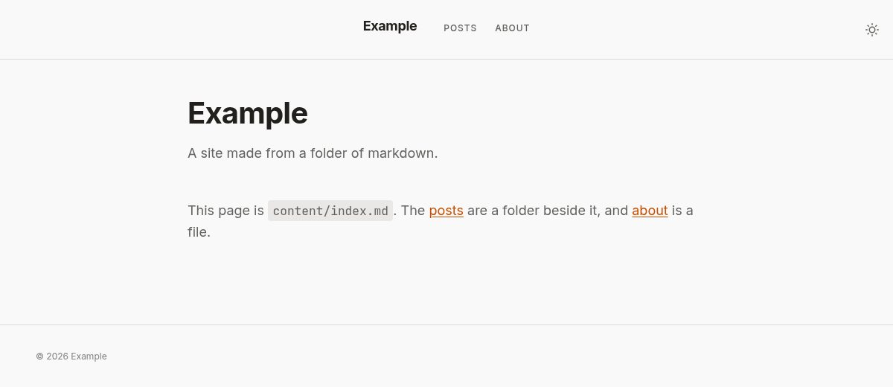
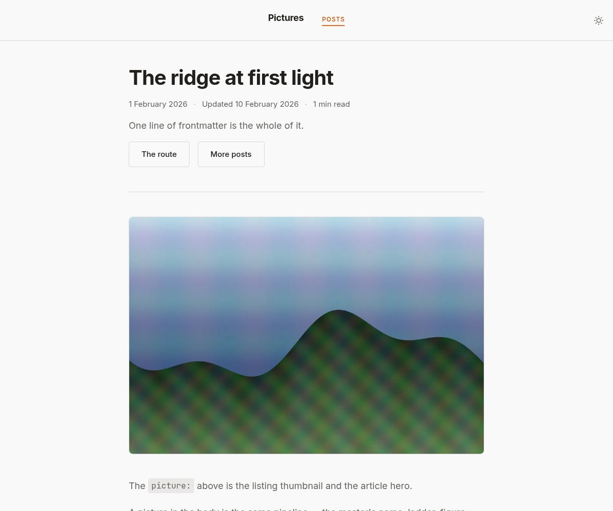
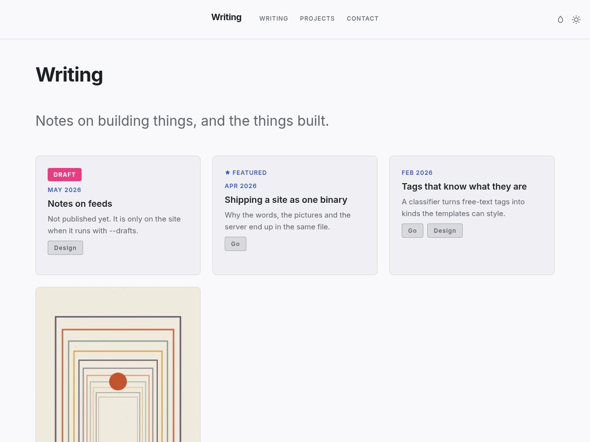
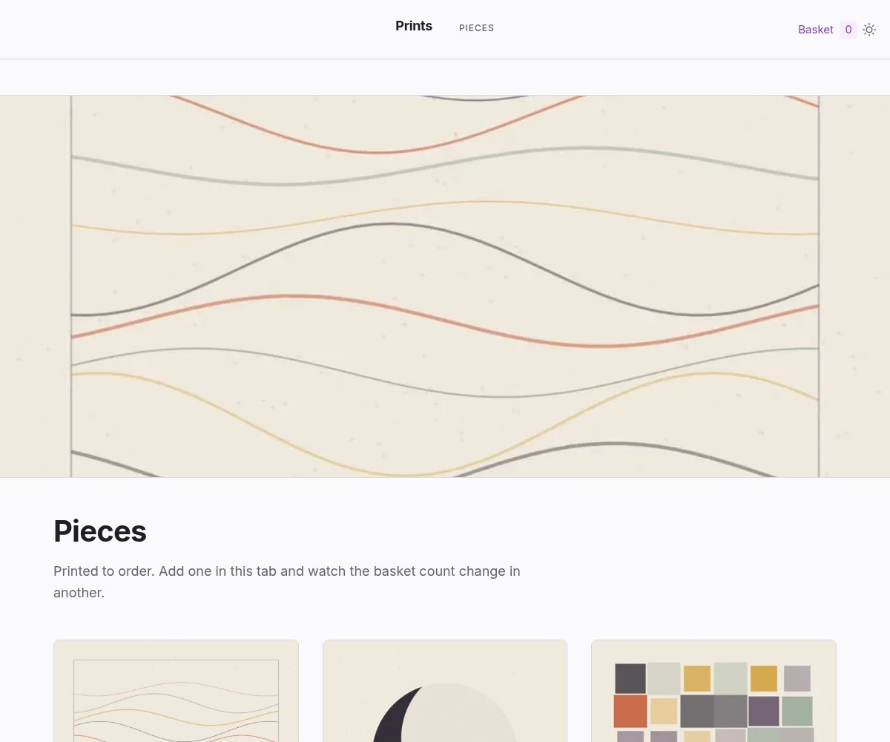
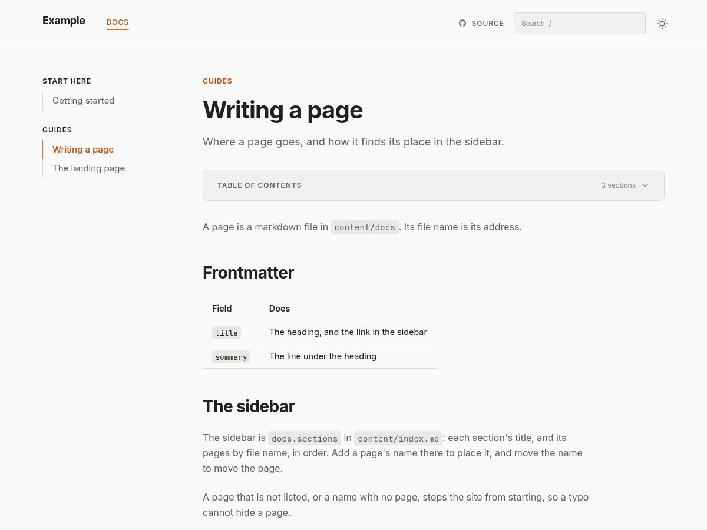
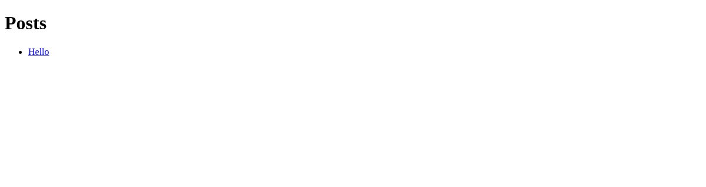

Each example is a complete site in the repository, commented part by part.
Each adds one thing to the one before, so they read in order, and each is a kind of site to start from.

Each but the last is also running on this site, beneath `/examples/`, from the same code and content.

`quire new` copies one into a new directory as a site of its own, with a `go.mod`, a Dockerfile and a justfile.
[Getting started](./getting-started.md#start-from-an-example) has its flags.

## A simple site

A folder of markdown and one call. `index.md` is the home page, `about.md` is a page, and the folder `posts` is a listing and a page for each file.
There is no template and no CSS. [A site from the folder](./content.md#a-site-from-the-folder) is how it works.



```sh
go run github.com/lahickey/quire/cmd/quire@latest new --from site mysite
```

The source is [`examples/1-site`](https://github.com/lahickey/quire/tree/master/examples/1-site).
It is [running here](/examples/site).

## A blog

The same one call, with more in its posts: a picture as the hero and the thumbnail, pictures in the body, a video, links and a diagram.
Nothing in the code asks for any of them. [A blog](./blog.md) goes through what each field does.



```sh
go run github.com/lahickey/quire/cmd/quire@latest new --from blog mysite
```

The source is [`examples/2-blog`](https://github.com/lahickey/quire/tree/master/examples/2-blog).
It is [running here](/examples/blog).

## A portfolio

A site with a look of its own. It has its own home page, a grid of projects and a contact page, a tag vocabulary, a widget, its own palette with a picker, its own stylesheets, icon and footer.
The writing and each article are still the default look, so it shows how much a site replaces and how much it leaves. [The look](./look.md) covers each part.



```sh
go run github.com/lahickey/quire/cmd/quire@latest new --from portfolio mysite
```

The source is [`examples/3-portfolio`](https://github.com/lahickey/quire/tree/master/examples/3-portfolio).
It is [running here](/examples/portfolio).

## A shop

Prints with a price, and a basket.
Each piece keeps its medium and its price in its frontmatter, the pages are the site's own, and the basket is a feature: its count and its lines update live in every open tab, and it works as plain forms without JavaScript.
It is handed a store and sessions, and has a page for whoever runs the shop behind a gate. [Features](./features.md) is written round it.



```sh
go run github.com/lahickey/quire/cmd/quire@latest new --from shop mysite
```

The source is [`examples/4-shop`](https://github.com/lahickey/quire/tree/master/examples/4-shop).
It is [running here](/examples/shop).

## Documentation

A documentation site from the docs pack: a landing page, the documents beside a sidebar, and search, with no templates or CSS.
This site is made the same way. [Packs](./packs.md) covers the docs pack.



```sh
go run github.com/lahickey/quire/cmd/quire@latest new --from docs mysite
```

The source is [`examples/5-docs`](https://github.com/lahickey/quire/tree/master/examples/5-docs).
It is [running here](/examples/docs).

## No look at all

The same folder of markdown as the simple site, with no pack beneath it: no stylesheet, no script, no frame.
Three small templates of its own draw a page, a listing and a document, so it is where to start for a look that is wholly yours.



```sh
go run github.com/lahickey/quire/cmd/quire@latest new --from naked mysite
```

The source is [`examples/6-naked`](https://github.com/lahickey/quire/tree/master/examples/6-naked).

## Two that are not starters

- [`mounted`](https://github.com/lahickey/quire/tree/master/examples/mounted) is a program with a mux of its own that mounts a Quire site under a path.
- [`several`](https://github.com/lahickey/quire/tree/master/examples/several) is two sites in one server, each from a folder of its own.

[Wiring](./wiring.md#in-depth) covers both.
