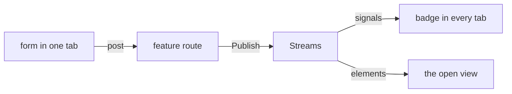

A feature is the one way to add to a site: a basket, a search box, a comment thread, or the site's own pages.
It declares what it adds, and a site includes it with one line.

## Including a feature

```go
if err := s.Include(basket.New(carts, visitors, "/basket", items...)); err != nil {
  return err
}
```

`Include` runs the feature on the site: its endpoints, its stylesheets, its control in the nav and its page.
The basket is told where its page goes, so the address is still the site's choice.
It is also handed the [services](#services) it uses: somewhere to keep its carts, and who each visitor is.

`examples/4-feature` is a shop built this way.

## Search

Quire ships one, in `feature/search`: a search box in the nav whose results arrive as the visitor types.
This site has it, at the top of the page.

```go
found := search.New("/search", searchui.Look())
found.Add(pages)
if err := s.Include(found); err != nil {
  return err
}
```

Search finds and does not draw. How its box and its results look is a `search.Look`, and `searchui.Look()`, from `pack/base/searchui`, is the default look's. A site with a look of its own hands in its own and keeps the search.

`Add` gives it a collection to index, one entry for each document's opening and one for each H2 and H3, held in memory. Call it for every collection the box should find.
The index is built on the first search, so a bake builds none.

An element marked `data-nosearch` is left out of the index, with everything inside it.
It is for a part of a page that is there to be looked at and would only crowd the results: a long listing, a generated table, a sample file.
The headings around it are still found, so the page is too.

```html
<details data-nosearch>
<summary>The whole file</summary>
...
</details>
```

[Lexis's languages](./languages.md) page marks each of its listings this way: search for a word that is only in one of them and it is not found, though the language's heading is.
In the box, `/` focuses it, up and down move through the results, and enter opens one.
Without JavaScript the form loads the results page instead, at the address `New` was given.

## Writing a feature

A `Feature` is two methods:

```go
type Feature interface {
  Name() string
  Declare(*site.Site) error
}
```

`Declare` says what the feature adds:

```go
func (p *Feature) Name() string { return "basket" }

func (p *Feature) Declare(s *site.Site) error {
  p.streams, p.log = s.Streams(), s.Log()
  s.AddStylesheets(css, "basket.css")
  s.AddNavEnd(p.nav())
  s.AddRoute("GET", s.URL("events"), p.events)
  s.AddRoute("POST", s.URL("add"), p.add)
  s.AddLivePage(p.at, p.livePage)
  s.In(site.Admin).AddLivePage("", p.adminPage)
  return nil
}
```

`Declare` only declares.
It runs in a bake as well as when the site is built to serve, and under `Run` that is twice in one program, so it sets what it keeps and never adds to it.
A bake serves nothing, so whatever a handler does cannot happen in one.
A feature is handed what it needs by its own constructor, and imports `site`, `model` and, for live updates, `libs/streams`.
One that draws with the default look's components imports `pack/base/ui` too, and is then tied to that look; one that takes its drawing as a parameter, as search does, is not.

### A name is a namespace

`Name` is one word, or nothing.

A feature with a name has a namespace of its own, and the site holds it there:

| It adds | The site allows |
|-|-|
| A route under `/_` | only under `/_<name>/` |
| A page or plain route | any address not taken |
| A stylesheet | classes that begin `<name>-` |
| A widget | named `<name>` or `<name>-…` |
| Streams | signals under `$<name>` |

It may not set the site's look: the frame, the home and not-found pages, the footer text, the fonts, how a picture is placed.
Two features of one name fail the build, and `quire` is kept for Quire's own.

A feature with no name works in the site's namespace.
The site's own is one, and so is a pack's, which is the site's look.
It may set all of the look, and has nothing under `/_` and no streams: those need a name.
A plain function is one, as `site.FeatureFunc`.

Whatever a feature includes takes its name with it, so a named feature cannot step outside through another.

## What a feature can do

A feature is given the whole `*site.Site`, so everything in [Wiring](./wiring.md) is open to it.
These are what a named one uses most.

### Routes and pages

- `s.URL(path)` is an address in the feature's namespace: `/_basket/add`.
- `s.AddRoute(method, s.URL(path), h)` is an endpoint there.
- `s.AddLivePage(path, page)` is a page drawn for each request: it is given the request and answers with the page's head data and its body.

```go
func (p *Feature) livePage(r *http.Request) (model.PageSpec, templ.Component) {
  return model.PageSpec{Title: "Basket", Path: p.at, NoIndex: true}, p.page(p.cart(r.Context(), p.visitors.Read(r)))
}
```

The site draws the document and the frame round the body, so a feature's page is a site page like any other, and the body alone is what a stream patches.

### Live updates

`s.Streams()` is the feature's `*streams.Streams`: Datastar SSE with a subscriber list, scoped by the feature's name.
The feature keeps it, to publish to and to draw with.

- `Subscribe(w, r, topic, send)` is the whole handler: it opens a connection, sends the current state and holds it open.
- `Publish(topic, send)` reaches every connection on that topic, so a change made in one tab lands in all of them.
- `Stream.Signals(v)` marshals `v` and merges it into the page's signals under the feature's name. The basket sends `{"count": 3}` and the page holds `$basket.count`, so two features cannot patch each other's.
- `Stream.Elements(ctx, component)` replaces the element with the same id.
- `Listen(path)` is the Datastar action that subscribes to a route: `data-init={ p.streams.Listen("events") }`. Quire ships Datastar, so it owns the options too: a subscription reconnects for as long as the page is open and closes when its element is removed.
- `Signals(v)` is a `data-signals` value under the feature's name, so a page starts with what `Stream.Signals` later patches: `data-signals={ p.streams.Signals(map[string]int{"count": 0}) }`.

### Forms

`@p.streams.Form(path) { … }` is a form that posts to a route: a plain post without JavaScript, and a Datastar post that stays on the page with it.
End its handler with `streams.Done(w, r)`, which answers either kind of caller: `204` to a live page, whose stream already carries the change, and a redirect for a plain form submission, back to the page it came from if that is on this site, otherwise to `/`.

### Styles, scripts, nav and the log

- `AddStylesheets` / `AddStylesheetsAt` from a named feature go into the `feature` cascade layer, so the site can restyle a feature and never the reverse. `AddStylesheetsAt` is CSS for one step of the scale; Scale writes the query.
- `AddScripts` adds JavaScript files to `/_quire/quire.js`, each in its own function scope. A file that is not there fails the build.
- `AddNavEnd(component)` is a control in the nav. A nil component fails the build.
- `AddBodyEnd(component)` ends every page's body with something nobody sees. Live reload is a feature that uses it.
- `UseDatastar()` links Datastar on every page. `Streams` does it too.
- `Log()` is a `*slog.Logger` under the feature's name, writing wherever the site's does.

## Groups

A group is a part of a site behind one gate, at the address of its name.
Quire names two, `site.Members` and `site.Admin`, and a site adds its own as one more constant: `const Staff site.Group = "staff"`.

A feature adds to a group, and never knows what guards it:

```go
admin := s.In(site.Admin)
admin.AddLivePage("", p.adminPage)       // /admin/basket
admin.AddRoute("POST", "refund", p.refund) // /admin/basket/refund
```

A named feature's addresses in a group are under the group's name and then its own, so every feature's admin pages sit together and cannot collide.
`admin.URL(path)` is where one ended up.

The site gives a group its gate, which wraps every handler in it:

```go
s.SetGroup(site.Admin, auth.Admins)
```

- **A group with no gate is not served.** Until the site calls `SetGroup`, nothing a feature added to the group has an address, so a feature's admin page can never be reached unguarded.
- **Nothing else gets inside.** A route added any other way at an address under a served group fails the build.
- **Order does not matter.** A feature may add to a group before or after the site sets its gate.
- **The gate is the site's to choose.** A named feature may not set one, and the site's word beats a pack's.

A gate is a `func(http.Handler) http.Handler`, so "is signed in" and "is signed in and an admin" are two gates, the second calling the first.
`examples/4-feature` gates `site.Admin` with a password when `SHOP_ADMIN` is set, and without it has nothing at `/admin` at all.

## Services

A service is something features call, and puts nothing at an address: a store, sessions, a mailer.
It is a plain value. The site makes it, adds it, and hands it to whatever uses it.

```go
func main() {
  carts, visitors := store.NewMemory(), sessions.New()
  quire.Run(identity, site.FeatureFunc(func(s *site.Site) error {
    s.AddServices(carts, visitors)
    return s.Include(basket.New(carts, visitors, "/basket", items...))
  }))
}
```

```go
type Service interface {
  Start(context.Context, model.Env) error
  Stop(context.Context) error
}
```

- **A constructor only keeps what it is given.** Connections and goroutines are opened in `Start`. A bake starts nothing, so a service does nothing in one.
- **Every service is added**, with `AddServices`, whether or not it has anything to start yet. One that grows a connection later then changes no site.
- **They start in the order added and stop in reverse**, when the site is served. If one will not start, those already started are stopped and the site does not serve.
- **`Start` is told the site's environment**, once: `model.Env` is its identity, whether it is in dev, and its logger. A service settles there what is fixed for the life of the site, and never works it out again for a request.
- **A feature takes a service as an argument**, typed by what it needs, so a missing one does not compile and a test passes its own.

### A store

`service/store` keeps bytes by key. What the bytes are is the feature's business: the basket keeps a cart as JSON under the visitor's id.

```go
type Store interface {
  Get(ctx context.Context, key string) ([]byte, bool, error)
  Put(ctx context.Context, key string, value []byte) error
  Delete(ctx context.Context, key string) error
  List(ctx context.Context, prefix string) iter.Seq2[string, []byte]
}
```

- `store.NewMemory()` is one that a restart empties.
- `store.Under(st, "basket")` is a store's keys beneath a name. A feature puts its own name there, so every feature can be handed the same store and none can read another's.

What has to ask questions of its data brings a database of its own, as a service.

### Sessions

`service/sessions` is who a visitor is, by a cookie.

- `visitors.ID(w, r)` is the visitor's id, given to them now if they had none. Ask before the response is begun.
- `visitors.Read(r)` is their id if they have one, for a page that only shows what they hold.

A visitor is given the `qsid` cookie the first time something asks who they are, so a site where nothing asks sets none.
It is kept to HTTPS when the site's address is `https` and it is not in dev, which the service settles when it starts; `sessions.New(sessions.Secure(false))` says otherwise.
Two cold tabs can race; last cookie wins. That is inherent to HTTP.

## CSS

The stylesheet is one sheet in four layers, `@layer base, feature, pack, site`, which fixes precedence but not collision: two features both styling `.line` still clash.
So a named feature prefixes every class with its own name (`.basket-line`, not `.line`), and the build fails on a stylesheet with a class outside that prefix.

> [!IMPORTANT]
> Layers beat specificity, so a bare `button {}` in a site sheet outranks a feature's `.basket-qty-btn`. A site that includes features should scope its element selectors.

## Per-visitor content on a cached page



A prepared page is one body for everyone, so it cannot carry a basket count.
It carries an empty badge instead, and a publish patches it per visitor.
The page stays immutable; only the patch differs.

## Datastar

Datastar is the small library Quire ships for live behaviour. A page declares what it wants in `data-*` attributes, and the server sends HTML or values over a stream.

### Syntax

Attribute syntax is `data-plugin:key`, colon not hyphen: `data-on:submit`, not `data-on-submit`.

> [!WARNING]
> A hyphen there does nothing at all and reports nothing. Keyless attributes (`data-text`, `data-signals`) work either way, which is what lets the mistake survive a casual test.

### Signals or elements

Choose the payload by what the audience can receive, and give each audience its own topic.
Signals are page-global and land wherever a tab happens to be, which suits a count in the nav.
Element patches need the element to exist, and Datastar warns `PatchElementsNoTargetsFound` otherwise, so a view-specific patch gets a topic only that view subscribes to.

### Where a subscription lives

Put a page-global subscription (a count, a badge) on chrome that is not swapped: a soft-nav replaces `main`, or a [region](./wiring.md#scripts) inside it, and nothing else.
A view-specific subscription lives on the view's own element, inside `main`, so leaving the page cancels it.

Two standing streams per tab stall HTTP/1.1 (six connections per host) at three tabs; a second stream only while that view is open does not. Production over TLS is HTTP/2 and multiplexes, so this bites in dev first and looks like the site hanging.
A hidden tab drops its stream and resubscribes on return.

### Push, always

Signalling a page so it turns around and fetches its own update is a round trip that should not exist.

## In depth

A publisher writes into another request's connection, so every write to a stream is serialised and carries a five-second deadline: one stalled reader cannot hold up the request that published to it.
A publish writes to all of a topic's streams at once.
An idle stream is sent a comment every 25 seconds, because proxies drop a silent connection.
